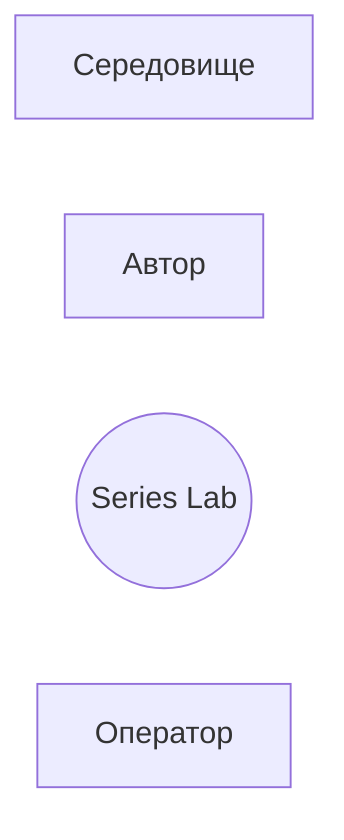
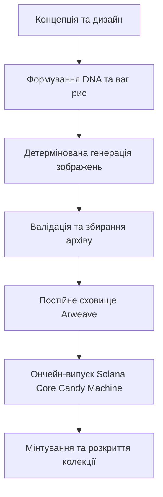
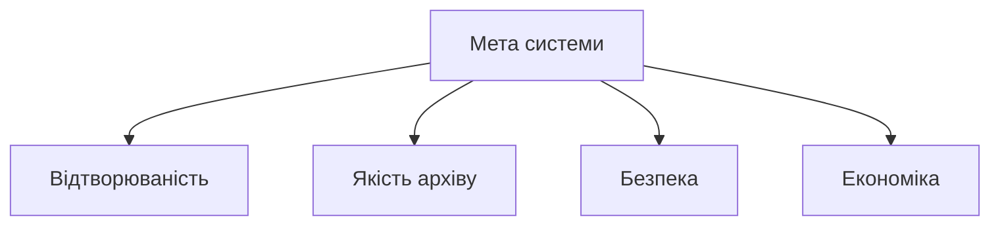

# РОЗДІЛ 1. АНАЛІЗ ПРЕДМЕТНОЇ ОБЛАСТІ

## 1.1 Системний аналіз задачі

Системний аналіз застосовується тут як метод формалізації мети, меж і структури майбутньої веб-системи до початку проєктування коду.

**Об'єкт дослідження** — процес створення колекції цифрових активів (NFT) з відтворюваним набором унікальних зображень і підготовки цієї колекції до публічного випуску в блокчейні.

**Предмет дослідження** — методи й програмні засоби детермінованої генерації описів (рецептів) елементів колекції, автоматичної перевірки готовності архіву до публікації, безпечної підготовки випуску в мережі Solana та обліково-платіжної підсистеми веб-сервісу без передачі приватних ключів на сервер.

**Мета системи** — провести автора від базової картинки серії до перевіреного архіву й набору для ончейн-випуску так, щоб: (1) той самий пресет і зерно завжди давали ті самі рецепти; (2) некоректний архів не потрапляв у постійне сховище; (3) приватні ключі ніколи не залишали ПК користувача; (4) оплата послуг відбувалася напряму в USDC у Solana.

**Стейкхолдери:**

| Роль | Інтерес | Як система відповідає |
|---|---|---|
| Автор колекції | швидко й безпечно зібрати унікальну серію й випустити її | майстерня з 7 етапів + CLI з локальним підписом |
| Оператор сервісу | стабільна робота, облік, резервні копії | адмін-вкладка, бекапи SQLite, журнал витрат |
| Покупець / мінтер | коректні метадані й розкриття | hidden → mint → reveal за стандартами Metaplex Core |
| Партнерські інтеграції | API без доступу до ключів автора | партнерські маршрути, окремі сесії |

**Межі системи.** До складу Series Lab входять: браузерна майстерня, HTTP-API, CLI, локальна БД користувачів/платежів, конвеєр зображень і підготовка наборів деплою/маркетплейсу. За межами системи лишаються: самі моделі генерації (зовнішні рушії), мережа Solana й програма Core Candy Machine, постійне сховище Arweave (через Irys), гаманці користувача та майданчики продажу (OpenSea тощо).

**Входи / виходи:**

| Входи | Виходи |
|---|---|
| базова картинка, пресет рис і ваг, зерно | рецепти з DNA, тексти запитів |
| ключі рушіїв (у середовищі сервера), кредити | PNG-кадри з версіями, журнал витрат |
| підтвердження відбору (keep/redo) | перевірений ZIP-архів випуску |
| публічна адреса отримувача USDC, підпис гаманця | кредити, `release.json`, набір деплою |
| локальний keypair лише в CLI | завантаження в Arweave, мінт, розкриття |

**Обмеження:** Node.js ≥ 22.13; приватні ключі не приймаються API; денний ліміт витрат; регіональна доступність залежить від гаманця користувача, а не від карткового еквайрингу.

**Критерії ефективності:** відтворюваність (`diff-seed`); унікальність DNA; блокування ZIP при помилках preflight; 0 витоків ключів у тілах запитів; одноразове зарахування платежу; проходження автоматичних тестів і перевірок документації.

Контекстну діаграму «система — користувач — середовище» наведено на рис. 1.1.

**Рисунок 1.1 — Контекстна діаграма Series Lab.**

## 1.2 Що саме робить система і навіщо це потрібно

Series Lab — це веб-сайт і локальна майстерня, які закривають розрив між «намалювати багато варіантів персонажа» і «випустити колекцію в блокчейні».

**Що робить користувач у системі (коротко):**

1. Задає паспорт серії (назва, ID, кількість, зерно, рушій) — вкладка «Огляд».
2. Завантажує або генерує **базову картинку серії** — «Основа».
3. Описує формулу: що лишити сталим, які риси й ваги змінювати — «Конструктор».
4. Будує відтворювані рецепти й DNA без малювання — «Рецепти».
5. Оцінює ціну й генерує кадри (хмарні рушії за кредити або `mock` / локальний GPU безкоштовно/дешево) — «Генерація».
6. Відбирає вдалі кадри, перегенерує невдалі зі збереженням версій — «Відбір».
7. Перевіряє архів і збирає ZIP для випуску — «Експорт»; далі «Деплой» / «Маркет».
8. На своєму ПК підписує завантаження, мінт і розкриття CLI — ключ не йде на сервер.
9. У публічному режимі входить гаманцем і купує кредити USDC напряму в Solana.

**Навіщо це потрібно.** Без єдиної системи автор змушений склеювати окремі генератори, перевіряльники метаданих і застарілі інструкції з випуску. Типові наслідки: невідтворювана серія, дублікати в постійному сховищі, випадкові витрати на API, витік ключа в «зручний» веб-інтерфейс. Series Lab потрібна, щоб:

- **зменшити ризик помилки** — ворота preflight блокують поганий ZIP;
- **зберегти гроші** — «Порахувати» до «Згенерувати», повернення кредитів при помилці, денний ліміт, автостоп;
- **зберегти контроль** — non-custodial: підпис і оплата лише на боці користувача;
- **дати повний шлях** — від ідеї до набору Core Candy Machine, а не лише «намалювати картинки».

Детальний життєвий цикл предметної області та проблеми аналогів — у наступних підрозділах.

## 1.3 Цифрові активи, NFT і колекції

NFT — це запис у блокчейні, що посилається на метадані (назву, опис, зображення, атрибути) і належить певній адресі. У Ethereum базовий інтерфейс описано стандартом ERC-721 [3]; роялті для вторинних продажів описує EIP-2981. У Solana використовують програми Metaplex: стандарт Token Metadata і новіший Core, для масового випуску — Core Candy Machine з набором правил мінту (Candy Guard). Для Bitcoin існують написи Ordinals.

Колекція зазвичай складається з тисяч елементів, що відрізняються набором **рис** (traits): фон, одяг, аксесуар тощо. Кожна риса має кілька **опцій** з **вагами** (імовірностями). Унікальність елемента визначається комбінацією значень — у цій роботі її названо **DNA** (впорядкований рядок «лінія | значення рис за порядком ключів»). Відношення фактичної частоти опції до очікуваної за вагами складає **звіт рідкості**.

Для відкритого ринку важливі також **провенанс** (хеш-ланцюг зображень, що фіксує порядок і незмінність набору до розкриття), **приховані метадані** (hidden settings: до розкриття всі елементи мають однакове посилання й хеш) і **розкриття** (reveal: заміна імені й посилання кожного активу на остаточні).

## 1.4 Життєвий цикл колекції та його проблеми

Типовий шлях автора:

1. Задати концепцію й базову картинку.
2. Описати риси, їхні опції й ваги, правила несумісності.
3. Побудувати комбінації й тексти запитів до генератора зображень.
4. Згенерувати зображення (рушії: Flux у різних варіантах, Stability, OpenAI, локальні ComfyUI та Automatic1111 тощо).
5. Відібрати кращі кадри, перегенерувати невдалі.
6. Зібрати архів: зображення, JSON-метадані за стандартом мережі, обкладинка, роялті, рідкість.
7. Завантажити файли в постійне сховище (Arweave) і отримати посилання.
8. Налаштувати програму випуску й правила мінту, виконати мінт і розкриття.
9. Перевірити стан у мережі, виставити колекцію на маркетплейсі.

Узагальнену схему життєвого циклу створення та ончейн-випуску NFT-колекції наведено на рис. 1.2.

**Рисунок 1.2 — Схема життєвого циклу створення та ончейн-випуску NFT-колекції.**

Основні проблеми, які виявлено під час аналізу (деякі підтверджено дослідженням в `docs/RECOMMENDATIONS.md`):

| Проблема | Наслідок |
|---|---|
| Кожен крок виконують різні інструменти | помилки перенесення, втрата версій файлів |
| Недетермінована генерація | неможливо відтворити серію чи довести її незмінність |
| Немає обов'язкової перевірки перед завантаженням | дублікати зображень, порожні чи биті метадані, неправильні адреси творців потрапляють у сховище, де їх не виправити |
| Генерація платна, помилка у скрипті пересилає гроші | невідтворювані витрати; перегенерація затирає оплачений кадр |
| Сторонні сервіси просять приватний ключ | ризик повної втрати коштів і колекції |
| Метаплекс позначив Legacy Candy Machine і Sugar застарілими | значна частина настанов в інтернеті застаріла |
| Ліцензії моделей різні (наприклад, ваги FLUX.1 [dev] мають некомерційну ліцензію) | юридичний ризик комерційного використання |
| Платіжні провайдери мають регіональні обмеження | не всі автори можуть оплатити послугу |

## 1.5 Огляд аналогів

Порівняння виконано за публічною документацією; перед поданням роботи перевірте актуальність кожного джерела (див. список літератури).

| Інструмент | Що робить | Чого бракує для задачі роботи |
|---|---|---|
| HashLips Art Engine | відкритий генератор зображень із шарів; ваги в іменах файлів; звіт рідкості | немає шляху випуску, оплати, перевірки готовності до Solana Core, версій оплачених кадрів |
| Sugar CLI (Metaplex) | завантаження ресурсів і розгортання Candy Machine | позначений застарілим; не створює колекцію й зображення |
| Metaplex CLI (`mplx`) і Core Candy Machine | сучасний шлях випуску в Solana | лише випуск; не генерує й не перевіряє архів у вигляді єдиного процесу |
| Thirdweb | випуск контрактів ERC-721, відкладене розкриття | EVM-орієнтований; не покриває Solana Core |
| Загальні AI-генератори зображень | створюють окремі картинки | немає понять DNA, ваг, унікальності, рідкості, архіву |
| Хмарні «all-in-one» конструктори NFT | часто пропонують повний шлях | зазвичай потребують довіри до платформи щодо коштів і/або ключів; закриті |

Висновок: ринок містить сильні вузькі інструменти, але немає відкритої системи, що (а) поєднує детерміновану генерацію й перевірку в одному потоці, (б) веде аж до набору для випуску в Solana Core і (в) принципово не торкається приватних ключів користувача.

## 1.6 Вимоги до безпеки: ключі, оплата, дані користувачів

Вимоги, що випливають з аналізу ризиків:

1. **Ключі.** Приватні ключі гаманців не передаються в браузер, на сервер і в чат; підпис і оплата виконуються на ПК користувача. Серверні платні ключі (наприклад, ключ оплати Irys) — окремий гаманець із малим балансом.
2. **Вхід.** Лише підписом повідомлення гаманцем (EIP-4361 для EVM, підпис повідомлення для Phantom); паролів і поштових адрес не потрібно.
3. **Оплата.** USDC напряму в Solana на публічну адресу; сервер лише читає ланцюг; кожен платіж зараховується один раз.
4. **Запити.** Захист від CSRF і DNS-rebinding для локального API; обмеження частоти; перелік дозволених хостів.
5. **Дані.** Користувач може видалити все, що створив; облік грошей лишається за вимогами обліку.
6. **Відмовляти безпечно.** Сумнівна відповідь мережі або каталогу означає відмову дії, а не дозвіл.

## 1.7 Постановка задачі

Розробити веб-систему (з консольним інтерфейсом) для підготовки колекції NFT до випуску в Solana, що відповідає вимогам розділу 1.6 й виконує задачі, перелічені у вступі. Критерії успіху:

| Критерій | Спосіб перевірки |
|---|---|
| Відтворюваність: однаковий пресет і зерно дають однакові рецепти | тест `diff-seed`, юніт-тести ядра |
| Унікальність: жодні два елементи не мають однакової DNA | тести генератора |
| Блокування некоректного архіву | тести preflight (помилки → HTTP 422, ZIP не записується) |
| Відсутність приватних ключів на сервері | тести `secrets`, огляд маршрутів |
| Одноразове зарахування платежу | тести платіжної підсистеми |
| Повторюваний шлях випуску | `series upload` відновлюється після обриву (`cache.json`) |
| Якість і документація | 414 тестів; `docs:check`, `audit:i18n`, `audit:ui` без помилок |

**Порівняння «до / після» впровадження Series Lab** (оцінка за типовим шляхом автора на 48–100 NFT):

| Параметр | Без єдиної системи | З Series Lab |
|---|---|---|
| Кількість інструментів | 4–6 (генератор, ZIP, Sugar/mplx, сховище, гаманець) | 1 майстерня + локальний CLI |
| Відтворюваність серії | зазвичай відсутня | гарантована зерном і `diff-seed` |
| Перевірка перед завантаженням | ручна / відсутня | обов'язковий preflight |
| Ризик передачі ключа | високий (веб-форми сторонніх сервісів) | ключ лише в CLI на ПК |
| Контроль витрат на генерацію | після факту | «Порахувати» → резерв кредитів → refund |
| Підготовка до Solana Core | окремі застарілі інструкції | набір деплою + `release.json` |

**Матриця трасування: вимога → модуль → перевірка** (фрагмент; повний перелік ФВ/НВ — у розділі 2.1):

| Вимога | Модуль / шлях | Тест або сценарій |
|---|---|---|
| ФВ-2, НВ-1 | `src/rng.mjs`, `src/build.mjs` | юніт-тести ядра; `diff-seed` (А7) |
| ФВ-3 | `src/dna.mjs`, `src/rules.mjs` | тести генератора / унікальності DNA |
| ФВ-5, НВ-9 | `src/engines.mjs`, `src/spend.mjs`, `src/pool.mjs` | тести генерації, ліміту, автостопу |
| ФВ-6 | `src/versions.mjs`, `src/trash.mjs` | тести версій і кошика |
| ФВ-8, НВ-5 | `src/preflight.mjs` | тести preflight; сценарій 2 |
| ФВ-10, НВ-2 | `bin/series.mjs`, `src/secrets.mjs` | тести `secrets`; сценарії 3, 5 |
| ФВ-11, НВ-4 | `src/platform/solpay.mjs`, `billing.mjs` | тести `solpay`, `platform`; сценарій 4 |
| ФВ-12 | `POST /api/account/delete-data` | тести платформи; сценарій 4 |
| ФВ-14, НВ-8 | `server/ui/locales/*` | `audit:i18n`, `audit:ui` (А3, А4) |
| НВ-8 | `docs/`, CI | `docs:check` (А2); GitHub Actions (А5) |

## 1.8 Дерево цілей і критерії ефективності

Ієрархію мети роботи, підцілей і вимірюваних критеріїв наведено на рис. 1.3. Вона пов'язує системний аналіз (розділ 1.1) з проєктуванням вимог (розділ 2.1) і протоколом випробувань (файл 15).

**Рисунок 1.3 — Дерево цілей і критеріїв ефективності Series Lab.**