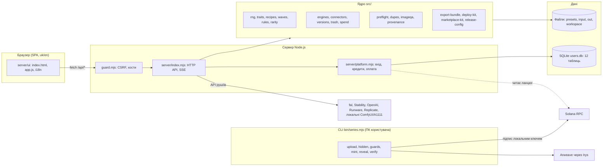
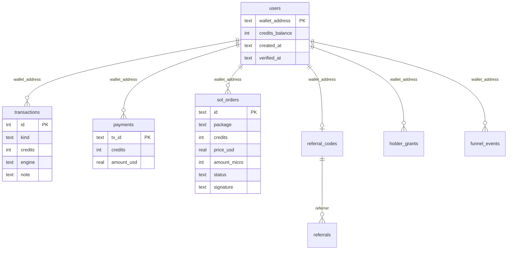
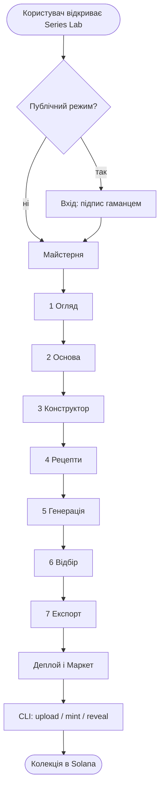

# РОЗДІЛ 2. ПРОЄКТУВАННЯ СИСТЕМИ

## 2.1 Функціональні й нефункціональні вимоги

### Функціональні вимоги

| Код | Вимога |
|---|---|
| ФВ-1 | Система зберігає **пресет** серії: назву, id, розмір, зерно, шаблон запиту, риси з опціями й вагами, лінії, правила, хвилі поставки (схема `series-preset/v0`). |
| ФВ-2 | Система будує **архів рецептів** (схема `series-archive/v0`) детерміновано з пресету без мережі й без ключів. |
| ФВ-3 | Система гарантує унікальність DNA в межах серії, враховує ваги, квоти ліній, правила несумісності, хвилі поставки. |
| ФВ-4 | Система зберігає базові зображення з ролями `primary`, `line`, `style`, `extra`; уміє створювати базу з опису й аналізувати її (Vision Assist). |
| ФВ-5 | Система генерує зображення кількома рушіями, показує оцінку ціни до запуску, веде журнал витрат і зупиняє пакет при серії помилок. |
| ФВ-6 | Перегенерація не затирає оплачений кадр: зберігаються версії; видалення переносить у кошик. |
| ФВ-7 | Відбір: keep/redo, порівняння наборів, перевірка схожості, евристична й AI-оцінка. |
| ФВ-8 | Експорт: ZIP із зображеннями й метаданими за стандартом мережі; **ворота перевірки** блокують некоректний архів. |
| ФВ-9 | Набір деплою для Solana Core Candy Machine, EVM, Ordinals; набір для маркетплейсу. |
| ФВ-10 | Консольний шлях випуску: `release-init`, `upload`, `hidden`, `guards`, `mint`, `reveal`, `verify`, підпис лише локальним ключем. |
| ФВ-11 | Публічний режим: вхід підписом гаманця, кредити, оплата USDC у Solana, реферальна програма, холдерські бонуси. |
| ФВ-12 | Користувач може видалити свої дані («Мої дані»). |
| ФВ-13 | Адміністрування: стан ключів, економіка, помилки, кошик, перевірка рушіїв. |
| ФВ-14 | Інтерфейс і довідка українською й англійською. |

### Нефункціональні вимоги

| Код | Вимога | Як досягається |
|---|---|---|
| НВ-1 | Відтворюваність | FNV-1a + mulberry32, чисті функції без мережі |
| НВ-2 | Безпека ключів | відсутність полів ключа в API, `secrets.mjs`, підпис у CLI |
| НВ-3 | Цілісність файлів | атомарний запис JSON (`fs-safe.mjs`: тимчасовий файл + `rename`) |
| НВ-4 | Цілісність грошей | усі зміни балансу в одній транзакції SQLite разом із записом у `transactions`; `payments.tx_id` — PRIMARY KEY |
| НВ-5 | Стійкість | відновлюване завантаження (`cache.json`), автостоп після 5 помилок поспіль, погодинні копії БД |
| НВ-6 | Мінімальні залежності | 6 пакетів часу виконання |
| НВ-7 | Переносимість | Node.js ≥ 22.13; Windows, Linux; Docker-образ на `node:24-alpine` |
| НВ-8 | Супроводжуваність | автотести, перевірка `npm run ci` (локально, хук pre-push), перевірка узгодженості документації |
| НВ-9 | Прозорість витрат | ціна до дії, журнал `render-log.jsonl`, денний ліміт |

## 2.2 Архітектура

Система складається з двох виконуваних компонентів із спільним ядром:

- **Сервер майстерні** (`server/index.mjs`): HTTP-сервер без веб-фреймворку на модулі `node:http`, що віддає статичний інтерфейс і API. Працює в двох режимах: `SERIES_MODE=local` (без акаунтів, лише loopback) і `SERIES_MODE=public` (вхід гаманцем, кредити, дані по гаманцях).
- **CLI** (`bin/series.mjs`): 25 команд; містить усі дії, що потребують ключів.
- **Ядро** (`src/*.mjs`): чисті бібліотеки без залежності від HTTP.
- **Платформа** (`src/platform/*.mjs`, `server/platform.mjs`): акаунти, кредити, платежі, статистика, захист.

Загальну архітектуру взаємодії компонентів системи наведено на рис. 2.1.

**Рисунок 2.1 — Загальна архітектура системи.**

Принципи, які визначили поділ:

1. **Чисте ядро.** Генерація рецептів, рідкість, перевірка архіву — чисті функції від даних. Це спрощує тестування й гарантує відтворюваність.
2. **Тонкий HTTP-шар.** Обробники маршрутів викликають ядро й записують файли.
3. **Ключі — лише в CLI.** Сервер ніколи не приймає приватних ключів.
4. **Два режими одним кодом.** Локальний режим (без акаунтів) і публічний (з акаунтами) розрізняються змінною середовища, а не гілкою коду.

### Структура каталогів

| Каталог | Призначення |
|---|---|
| `bin/` | CLI |
| `src/` | ядро (69 файлів) |
| `src/platform/` | акаунти, оплата, статистика, захист (19 модулів) |
| `server/` | HTTP-сервер, захист запитів, платформні маршрути |
| `server/ui/` | браузерний інтерфейс і локалі uk/en |
| `schemas/` | JSON Schema пресету й архіву |
| `presets/`, `libraries/traits/` | демо-пресети, паки рис (pfp-core, brand-mascot, fine-art, abstract-series) |
| `scripts/` | аудити, резервні копії, збірка сайту, перевірка документації |
| `deploy/series-lab/` | Docker Compose, Caddy, скрипти розгортання й копій |
| `test/` | 74 файли тестів |
| `docs/` | документація проєкту |

## 2.3 Модель даних

### Файлові дані

У локальному режимі й у публічному (для кожного гаманця окремо) дані зберігаються файлами:

| Файл / тека | Зміст |
|---|---|
| `presets/<id>.json` | пресет серії |
| `input/` | базові зображення (`primary.*`, `base-<line>.*`, `style-*`, `extra-*`) |
| `out/<set>/<n>.png` | поточна версія кадру |
| `out/<set>/versions/<n>/v<k>.png`, `meta.json` | історія версій |
| `out/trash/` | кошик |
| `out/render-log.jsonl` | журнал платних викликів |
| `out/bundles/*.zip` | архіви випуску |
| `workspace/current.json` | автозбереження робочого стану |

Усі JSON записуються атомарно: у тимчасовий файл поряд із цільовим, потім `rename`; на Windows є повтори при `EPERM/EBUSY`.

### Реляційна БД (`users.db`, SQLite)

12 таблиць. Режим WAL і погодинні копії забезпечують надійність.

| Таблиця | Призначення | Ключ |
|---|---|---|
| `users` | гаманець, баланс кредитів, дата верифікації | `wallet_address` |
| `payments` | зараховані платежі (унікальний `tx_id`), сума USD, кредити | `tx_id` |
| `transactions` | журнал змін балансу: вид, кредити, рушій, нотатка | `id` |
| `wallet_nonces` | одноразові числа для входу | `wallet_address` |
| `sol_orders` | замовлення на оплату USDC: пакет, кредити, сума в мікро-USDC, статус, підпис транзакції | `id` |
| `referral_codes` | реферальні коди гаманців | `code` |
| `referrals` | запрошені, винагороди | `invitee_address` |
| `holder_grants` | бонуси власників NFT за період | `(wallet_address, period)` |
| `nft_fulfillments` | видача NFT (вимкнена за замовчуванням) | `tx_id` |
| `funnel_events` | події воронки | — |
| `b2b_keys` | ключі партнерського API, квоти | `api_key` |
| `freemium_usage` | не використовується, залишена для сумісності зі старими БД | `(wallet_address, day)` |

Зв'язки між основними сутностями реляційної бази даних наведено на рис. 2.2.

**Рисунок 2.2 — ER-діаграма основних таблиць (зв'язки логічні; зовнішніх ключів SQLite не оголошено).**

### Пресет і архів

Пресет (`series-preset/v0`) обов'язково містить: `schema`, `id`, `name`, `seed`, `size`, `base`, `promptTemplate`, `traits`; необов'язково: `lines`, `engine`, `rules`, `waves`. Архів (`series-archive/v0`): `schema`, `presetId`, `createdAt`, `seed`, `size`, `recipes`. Перевірка схем виконується бібліотекою Ajv.

## 2.4 Проєктування API

HTTP-API має 95 маршрутів, згруповані за призначенням (повний перелік — Додаток В):

| Група | Приклади |
|---|---|
| Стан і ресурси | `/api/health`, перевірка рушіїв |
| Пресети, шаблони, паки | список, збереження, застосування паку |
| Рецепти, архів, рідкість | збір, `diff-seed`, звіт рідкості, lint |
| Базові зображення | `upload`, `generate`, `analyze` (Vision Assist) |
| Генерація | оцінка, запуск, SSE-прогрес |
| Відбір | набори, мітки, triage, дублікати, схожість |
| Експорт | чекліст, `bundle`, `dataset`, `deploy-kit`, `marketplace-kit`, preflight |
| Версії, кошик, витрати | відновлення, журнал |
| Кредити, акаунт, адміністрування | `/api/me`, `/api/credits/sol/...`, `/api/account/delete-data`, економіка |

Правила проєктування API:

1. Помилки повертаються у вигляді `{"detail": …}` із відповідним статусом (наприклад, 422 для архіву, що не пройшов перевірку).
2. Тіла запитів із полями `privateKey`, `secretKey`, `mnemonic`, `seedPhrase`, `secret`, `password` відхиляються з кодом `secrets`.
3. Довгі операції (генерація пакета) повідомляють прогрес через SSE.
4. Кожна зміна API супроводжується оновленням `docs/API.md` (перевіряє `docs:check`).

## 2.5 Проєктування безпеки

| Загроза | Захід | Модуль |
|---|---|---|
| Сторінка в браузері надсилає запити на локальний API (CSRF) | перевірка `Origin`/`Host` | `server/guard.mjs` |
| DNS-rebinding | перелік дозволених хостів `SERIES_ALLOWED_HOSTS` | `server/guard.mjs` |
| Відкритий доступ без акаунтів із зовнішньої адреси | локальний режим слухає лише loopback, інакше процес відмовляє | `openAccessError` |
| Підроблений токен сесії | HMAC-SHA256 над стисненим JSON, порівняння `timingSafeEqual`; без `AUTH_SESSION_SECRET` вхід вимкнено | `session.mjs` |
| Повторне використання підпису | одноразовий `nonce`, TTL 5 хв; сесія 4 год | `session.mjs`, `wallet_nonces` |
| Витік ключа через API | відхилення полів ключів | `secrets.mjs` |
| Подвійне зарахування платежу | унікальний `tx_id`, транзакція SQLite | `billing.mjs`, `solpay.mjs` |
| Втрата грошей через помилку генерації | резервування кредитів до запуску, повернення при помилці | `server/index.mjs` |
| Неконтрольовані витрати | денний ліміт, автостоп, журнал | `spend.mjs` |
| Переповнення запитів | ковзне вікно, обмеження частоти | `ratelimit.mjs` |
| Небезпечний контент у запиті | перевірка вмісту, фільтр брендів | `safety.mjs`, `lint.mjs` |
| Втрата БД | погодинні копії, перевірка цілісності, копія на ПК оператора | `sqlite-backup.mjs`, скрипти |

Принцип «відмовляти безпечно»: у модулі видачі NFT сумнівна відповідь каталогу або RPC означає відмову передачі.

## 2.6 Проєктування інтерфейсу та взаємодії з користувачем

Інтерфейс — односторінковий застосунок без фреймворку: `index.html`, `app.js` (≈ 5,8 тис. рядків), `i18n.js`, `style.css`. Структура — вкладки в порядку шляху користувача:

1. Огляд (паспорт серії) → 2. Основа → 3. Конструктор → 4. Рецепти → 5. Генерація → 6. Відбір → 7. Експорт → Деплой → Маркет; додатково Адмін і Довідка.

**Блок-схема взаємодії з користувачем** (рис. 2.3) відображає повний сценарій: від відкриття сайту й (за потреби) входу гаманцем через сім етапів майстерні до локального CLI-випуску. Пунктирна гілка показує поповнення кредитів USDC, яке потрібне лише для платної генерації.

**Рисунок 2.3 — Блок-схема взаємодії користувача з Series Lab.**

Принципи UX:

- **Шлях новачка** (смуга Lab → Studio → Випуск → Деплой → Маркет) поряд із прямим доступом до будь-якої вкладки.
- **Ціна до дії**: кнопка «Згенерувати» доступна лише після безкоштовного «Порахувати».
- **Підказки при наведенні** на кожному керуючому елементі; довідка-путівник із пошуком; FAQ; словник.
- **Показувати лише те, що стосується вибору**: поради залежать від мережі й профілю.
- **Єдина термінологія**: «базова картинка серії».
- **Двомовність**: 1752 ключів локалізації, збіг ключів uk/en перевіряється автоматично.
