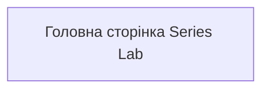
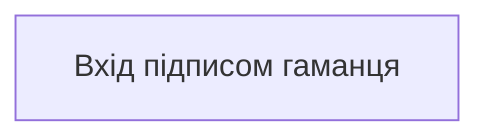
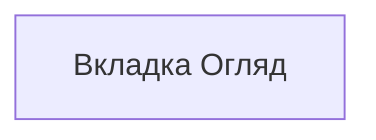
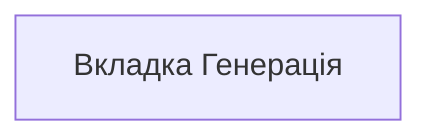
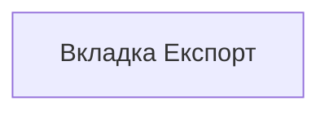
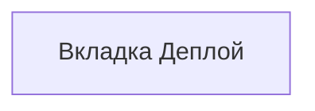
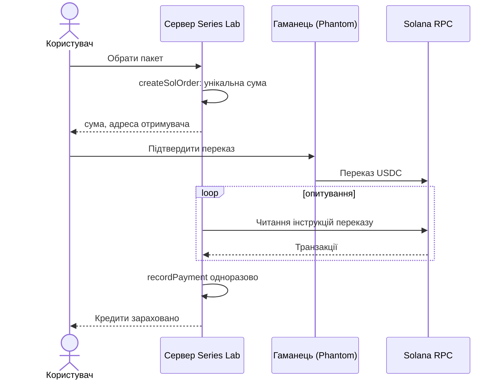

# РОЗДІЛ 3. ПРОГРАМНА РЕАЛІЗАЦІЯ

## 3.1 Вибір технологій

| Рішення | Вибір | Обґрунтування |
|---|---|---|
| Мова й середовище | JavaScript (ES-модулі), Node.js ≥ 22.13 | одна мова для сервера, CLI й інтерфейсу; вбудований `node:test`; вбудований `node:sqlite`; офіційні SDK Solana й Irys для JavaScript |
| HTTP | модуль `node:http` без фреймворку | менше залежностей і поверхні атаки; потрібен лише невеликий маршрутизатор |
| БД | SQLite через вбудований `node:sqlite` (`DatabaseSync`), режим WAL | один файл, транзакції ACID, прості копії; не потрібен окремий сервер |
| Тести | `node --test` | без зовнішніх залежностей |
| Інтерфейс | HTML + модулі JS без збирання | немає етапу збирання; один файл `app.js`, локалізація в `locales/*.js` |
| Схеми | JSON Schema + Ajv | перевірка пресету й архіву |
| Архіви | JSZip | створення й безпечне розпакування ZIP |
| Крипто | `@noble/curves`, `@noble/hashes` | перевірені чисто-JS реалізації підписів і хешів |
| Solana | `@solana/web3.js`, `@solana/spl-token` | побудова й читання транзакцій USDC |
| Розгортання | Docker (`node:24-alpine`), Docker Compose, Caddy як зворотний проксі | прості, відтворювані |
| Перевірка | `npm run ci` локально (хук pre-push); GitHub Actions лише для сайту й моніторингу | ті самі тести, `docs:check` і аудити, без хмарного CI |

У `package.json` лише шість залежностей часу виконання: `@noble/curves`, `@noble/hashes`, `@solana/spl-token`, `@solana/web3.js`, `ajv`, `jszip`. Менше залежностей — менше ризиків ланцюга постачання.

## 3.2 Ядро: детермінований генератор рецептів

### 3.2.1 Генератор псевдовипадкових чисел

Вимога НВ-1 (відтворюваність) вимагає, щоб той самий пресет і зерно завжди давали ті самі рецепти на будь-якій машині. Використано поєднання:

- **FNV-1a (32 біти)** — для перетворення рядкового зерна на число [18];
- **mulberry32** — швидкий 32-бітний PRNG;
- **зважений вибір** — за кумулятивною сумою ваг;
- **перемішування Фішера—Єйтса** [19] — для остаточного порядку.

Фрагмент `src/rng.mjs`:

```js
export function hashSeed(text) {
  let h = 0x811c9dc5; // FNV-1a 32-bit offset basis
  const s = String(text);
  for (let i = 0; i < s.length; i++) {
    h ^= s.charCodeAt(i);
    h = Math.imul(h, 0x01000193);
  }
  return h >>> 0;
}

export function makeRng(seed) {
  let a = typeof seed === "number" ? seed >>> 0 : hashSeed(String(seed));
  const next = () => {
    a = (a + 0x6d2b79f5) >>> 0; // mulberry32
    let t = a;
    t = Math.imul(t ^ (t >>> 15), t | 1);
    t ^= t + Math.imul(t ^ (t >>> 7), t | 61);
    return ((t ^ (t >>> 14)) >>> 0) / 4294967296;
  };
  // ...weighted(options), shuffle(list)
}
```

Обидва алгоритми не є криптографічними: вони не призначені для захисту, а лише для відтворюваності. Секретів і ключів вони не стосуються.

### 3.2.2 DNA й унікальність

DNA елемента — рядок `лінія|значення_1|значення_2|…`, де значення беруться в порядку ключів рис, які входять у DNA (риси з `skipDna: true` малюються, але в DNA не входять):

```js
export function dna(line, traits, traitKeys) {
  return [line, ...traitKeys.map((k) => traits[k] ?? NONE)].join("|");
}
```

### 3.2.3 Алгоритм побудови

Вхід: пресет (риси з опціями, вагами, обмеженнями за лініями, `since` для хвиль), зерно, розмір. Вихід: масив рецептів. Алгоритм (функція `rollChunk`):

1. Визначити лінії й квоти (`quotasOf`): явні квоти мають сумуватись у `size`; інакше рівний розподіл із розподілом залишку.
2. Для кожної лінії, поки `made < need`, кинути риси: для кожної активної риси вибрати опцію за вагами серед доступних для лінії (`optionsFor`).
3. Якщо задано опції з `exact` (точна кількість), риса береться з заздалегідь перемішаної «колоди», що гарантує точні кількості.
4. Якщо набір порушує правила несумісності (`rules.conflicts`, пари `ключ:значення`), спроба відхиляється й лічильник конфліктів збільшується.
5. Обчислити DNA; якщо вона вже є в множині `seen`, спроба відхиляється.
6. Інакше елемент приймається.
7. Обмеження `MAX_ATTEMPTS = 100 000` на лінію: якщо унікальних комбінацій замало, генератор зупиняється з поясненням (потрібно «N, зроблено M» і кількість відхилених конфліктів).
8. Перемішати результат (`shuffle`), щоб лінії не йшли блоками.

Це **відбір із відхиленням (rejection sampling)**: простий і коректний, поки простір комбінацій значно більший за розмір серії. Для кожного рецепта додатково обчислюється власне зерно `hashSeed("<зерно>:<індекс>")`, що дає незалежну відтворюваність кадру.

### 3.2.4 Хвилі поставки, правила, рідкість

- **Хвилі**: наступна партія отримує власне зерно й номери після вже побудованих; попередні рецепти не змінюються (`waves.mjs`).
- **Правила**: `rules.mjs` розбирає пари `key:value`, збирає правила пака й пресету.
- **Рідкість** (`rarity.mjs`): фактична частота опцій проти очікуваної за вагами; додатково обчислюється інформаційна міра OpenRarity — сума −log₂P за шарами [12], де відсутній шар рахується як «null».
- **Рівні рідкості**: опція з полем `exact` («рівно N») з'являється в серії точно N разів: 1 — це 1/1, більше — рідкісний «грааль»; решта кадрів розподіляється за вагами. Сума `exact` однієї риси не може перевищувати розмір серії, інакше збірка зупиняється з назвою риси. У Конструкторі кнопка «1/1» ставить `exact: 1`, а підсумок під таблицею опцій показує, скільки кадрів закріплено. У відомих колекціях рідкість теж задана наперед (у CryptoPunks 9 прибульців і 24 мавпи з 10 000 [29]).
- **Промпт**: `buildPrompt` збирає запит із ключових частин: «keep» (що лишити), «Change» (що змінити за ключами), «Also add» (додаткові риси), блок «Style lock» (кут, світло, настрій, кадрування), примітка й суфікс.

### 3.2.5 Перевірка стабільності DNA

Команда `series diff-seed` будує архів двічі з того самого пресету й порівнює результати: розбіжність означає порушення детермінізму. Те саме доступно через `POST /api/diff-seed`.

## 3.3 Конвеєр зображень, версії, кошик, ліміт витрат

**Рушії** (`engines.mjs`, `connectors.mjs`): fal, kontext, comfyui, a1111, runware, openai, stability, pollinations і службовий `mock` (генерує зображення без викликів зовнішніх API, 0 кредитів). Ключі читаються лише з середовища (`keys.mjs`). Запити мають тайм-аут 4 хвилини, опитування Replicate — до 5 хвилин. **Сила референсу** (0,1…0,95) переводиться в параметри кожного рушія окремими функціями (`strengthForFal`, `strengthForStability`, `strengthForRunware`).

**Оцінка ціни до дії.** Кнопка «Згенерувати» доступна лише після безкоштовного «Порахувати». Формула кредитів описана у розділі 5.

**Версії** (`versions.mjs`): `out/<набір>/<номер>.png` — поточна версія; усі інші лежать у `versions/<номер>/v<k>.png` з `meta.json` (рушій, зерно, час). Перегенерація не затирає оплачений кадр; байти кожної версії зберігаються в єдиному місці, тому історія не збільшує обсяг для поточного зображення.

**Кошик** (`trash.mjs`): видалення й заміна переносять файл у `out/trash/`; кадр із Відбору відновлюється на тій самій вкладці.

**Журнал і ліміт** (`spend.mjs`): кожен платний виклик дописується до `out/render-log.jsonl` (час, джерело, рушій, набір, успіх, вартість у USD, помилка). Денний ліміт `SERIES_SPEND_CAP_USD` блокує запуск, якщо пакет перевищить його; значення `""`, `off`, `0` вимикають ліміт. **Автостоп** (`pool.mjs`): якщо рушій повертає помилку 5 разів поспіль, пакет зупиняється, щоб не спалити решту черги.

**Атомарний запис** (`fs-safe.mjs`): вміст пишеться в тимчасовий файл поряд із цільовим, потім `renameSync`; для Windows є повтори при `EPERM/EBUSY/EACCES`, оскільки антивірус може на мить блокувати файл.

**Нормалізація формату** (`png-normalize.mjs`): кожен рушій обгортається так, що `generate` віддає справжній PNG. Живий тест показав, що Pollinations повертає JPEG, який зберігався під іменем `N.png`: порівняння з базою падало з помилкою «not a png», а на Arweave файл ішов із типом `image/png` і JPEG-байтами. JPEG, WebP і GIF тепер перетворюються через `sharp`; без нього байти лишаються як були, а Node друкує одне попередження. Уже збережені кадри виправляє команда `series repair-png <тека-набору> [--dry-run]` (поточні кадри й `versions/`; хеші змінюються, тому раніше зібрані набори треба перебудувати).

**Стиснення до 1 МБ** (`compress.mjs`, вкладка «Експорт»): Metaplex просить тримати файли до 1 МБ. Спершу зменшується кількість кольорів (палітрова PNG, розмір картинки лишається), якщо цього мало — картинка зменшується до 50 % сторони, не нижче 512 пікселів. Менший файл стає новою версією кадру, оригінал лишається в `versions/`. На реальному кадрі 1,62 МБ → 0,58 МБ без зміни розміру. Кадр, що не вмістився в ліміт, лишається без змін і потрапляє у звіт.

## 3.4 Відбір, перевірка архіву, рідкість

**Відбір** (вкладка 6): позначки keep/redo; версії; порівняння двох наборів поруч; мініатюра 64 px; схожість до базової картинки (попередження, не блокування); автоматичний triage (евристичний безкоштовний, AI-варіант за тарифом).

**Пошук візуальних двійників** (`dupes.mjs`): середній хеш (aHash) зменшеного PNG; відстань Геммінга між хешами; декодер PNG реалізовано власноруч на `node:zlib` (фільтри Paeth, 8-бітні RGB/RGBA), без сторонніх бібліотек. Інші формати пропускаються.

**Схожість до базової картинки** (`similarity.mjs`): порівнюються гістограми напрямів країв (HOG) верхньої центральної частини кадру, колір ігнорується (шарф і фон — риси, що змінюються). Обрізка кадру шукає найкращий збіг у межах зсуву й масштабу камери. Метод `hog-aligned-1`, поріг попередження 0,73. Раніше стояв середній хеш: на живому тесті запас між «своїми» і «чужими» кадрами був 0,016, нині 0,084. Метрика не розпізнає обличчя: дзеркальна копія бази оцінюється як сама база; вона припускає центроване кадрування по груди.

**Панель якості серії** (`quality.mjs`, `GET /api/quality`, вкладка «Відбір»): за один прохід показує файл не PNG, замалий файл, точні копії (SHA-256 файлу; нечіткий хеш для цього не підійшов, бо кадри однієї серії мають однакову композицію і він позначав 7 кадрів з 8), кадри далеко від бази; пояснює, що робити з кожним видом проблем, і одним кліком позначає проблемні кадри «Переробити», не чіпаючи ваші «Лишити». Перевірка безкоштовна й локальна; чи видно заявлені риси (фон, шарф), вона не перевіряє — це лишається за автовідбором.

**Ворота перевірки** (`preflight.mjs`) — серце вимоги НВ-5 і ФВ-8. Помилки блокують завантаження (HTTP 422, ZIP не записується), попередження — лише інформують. Основні перевірки:

| Рівень | Приклади |
|---|---|
| Помилка | немає `name`/`image`; `attributes` не масив; `trait_type` порожній; для Solana немає `symbol`, `seller_fee_basis_points` не ціле, немає `properties.files`; роялті поза 0–10000 bps; частки творців не дорівнюють 100; порожня адреса творця; точні дублікати зображень (SHA-256) |
| Попередження | роялті > 50 % (майданчик може відхилити) або 0; адреса творця — заглушка (`1111…`, `0x000…`); файл більше 1 МБ (рекомендація Metaplex для Core Candy Machine [6], жорсткий ліміт — `PREFLIGHT_MAX_IMAGE_BYTES`, типово 20 МБ); візуально близькі зображення |

**Провенанс** (`provenance.mjs`): SHA-256 кожного зображення, конкатенація у фінальному порядку й хеш цього рядка — за схемою, відомою з практики колекцій [27]. Це дозволяє довести, що набір не змінювався після фіксації.

**Перевірка провенансу без Series Lab** (`provenance-verifier.mjs`): у кожному ZIP лежить `verify-provenance.mjs`, окремий файл без залежностей (лише `node:crypto` і `node:fs`), що відтворює хеш за картинками з `images/` і `provenance.json`. Правило записано в шапці файлу: SHA-256 кожної картинки, порядок за номером видання, склейка без роздільників, SHA-256 цього рядка. Помилками (код виходу 1) є: два видання з однаковою картинкою (незалежний розбір BAYC не відтворив опублікований хеш у 32 записах, 31 з яких мали спільний хеш [27]), запис, що суперечить сам собі, невідповідність `count`, номер видання двічі, небезпечне ім'я файлу (`../`). Попередження: пропуски в нумерації, зайві зображення, `.png` не з PNG-байтами. Той самий код виконує `series provenance --verify`, тож розбіжності між ними немає.

**Людський внесок** (`authorship.mjs`, вкладка «Експорт»): автор за бажанням заявляє, звідки базова картинка (намальована вручну, фото чи колаж, згенерована ШІ й доопрацьована, згенерована без правок), чи вручну правив кадри або малював шари, і лишає примітку. До заяви студія додає факти зі свого журналу: скільки кадрів автор позначив «Лишити», скільки перегенеровано й скільки версій усього. Усе пишеться в `authorship.json` і в блок README архіву (uk і en); без заяви лишаються лише факти. Це заява автора й журнал дій, а не юридичний висновок: Бюро авторських прав США (29.01.2025) захищає людський вибір, розташування й зміну, а не сам промпт [25].

**Гібридні шари «ШІ + ручні»** (`layers.mjs`, `series compose --over`, список «Накласти на» на вкладці «Генерація»): раніше «Скласти шари» складало всі риси з PNG поверх базової картинки й вимагало шару для кожної риси. Тепер шари можна накласти поверх кадрів, які вже намалював ШІ: `overlaySet` для кожного видання бере кадр набору, фарбує лише риси, для яких є файл шару (`skipMissing`, за потреби `only`), а решту лишає як намалювала модель, і записує новий набір `<набір>-layers` із `dna.json` (скільки кадрів змінено, які риси пропущено). Вихідний набір не змінюється, результат детермінований, нова назва одразу доступна для відбору й експорту.

**Позначка «створено ШІ» і підпис C2PA** (`ai-mark.mjs`, `c2pa-sign.mjs`, команда `series c2pa`): експорт за замовчуванням записує в кожен PNG XMP-пакет з типом джерела IPTC `trainedAlgorithmicMedia` (чанк `iTXt` вставляється перед `IDAT` без перекодування, піксельні дані не змінюються), а `ai-disclosure.json` у ZIP перелічує позначені кадри. Це не підпис: метадані можна стерти. Криптографічний шар дає команда `series c2pa`: на комп'ютері користувача вона підписує кадри маніфестом C2PA (`c2pa.created` з тим самим типом джерела) власним сертифікатом; ключ не залишає ПК, а бібліотеку `@contentauth/c2pa-node` користувач ставить сам. Експорт не змінює вже підписані кадри. Підпис із власним сертифікатом валідатори показують як «untrusted» (перевірено живим прогоном 10.10.2026); довіряний сертифікат сервісу не потрібен, бо сам сервіс нічого не підписує. Рішення, варіанти й джерела: `docs/C2PA.md`.

## 3.5 Шлях випуску: від архіву до мінту

Принцип: **сервер готує, CLI підписує**. Послідовність:

```
архів → release-init → [Експорт: набір деплою] → upload → hidden → (деплой mplx) → guards → verify → mint → reveal --keypair
```

| Команда | Дія | Ключ потрібен? |
|---|---|---|
| `series release-init` | створює `release.json` — єдине джерело істини (назва, символ, розмір, роялті, творці, ціна, allowlist, дані розгортання) | ні |
| `series upload <тека> --keypair` | відновлюване завантаження в Arweave через Irys; після **кожної** позиції оновлює `cache.json`; перед оплатою оцінює вартість у SOL, порівнює з балансом Irys, дозволяє `--max-price`, `--no-fund`, `--dry-run` | так, локально |
| `series hidden` | обчислює SHA-256 прихованих метаданих для Core Candy Machine | ні |
| `series guards` | генерує конфігурацію правил мінту (оплата, дата старту, ліміт на гаманець, список дозволених як група `allowList`) | ні |
| `series verify` | звіряє стан Core Candy Machine або v3 у мережі з `release.json` (лише читання) | ні |
| `series mint` | підписує мінт Core Candy Guard на цьому ПК; доказ приналежності до списку — всередині транзакції | так, локально |
| `series reveal` | підписує оновлення імені й посилання `UpdateV1` ключем оновлення колекції | так, локально |

**Деталі коректності:**

- Ціна передається в **лампортах** — цілим числом, без похибок плаваючої коми.
- Листок дерева Меркла для списку дозволених — `keccak256` від тексту адреси в base58 (не від сирих байтів); пари сортуються як беззнакові байти.
- Оновлення guard замінює весь набір правил, тому платіж (`solPayment`) входить завжди, а без коректної ціни й творця файл не створюється.
- Для пресету з `genesis: true` базова картинка входить у колекцію як видання №0, а `size` у `release.json` збільшується на 1.
- **Ліцензія власника на зображення** (`holder-licence.mjs`): у пораднику запуску вкладки «Деплой» автор обирає модель — лише особисте використання, особисте й комерційне використання власником, комерційне до річного ліміту доходу або відмова від прав за зразком CC0. Чернетка підставляє назву колекції й адресу творця, лишає пропуски для того, чого система не знає (обмеження, застосовне право, позначка ШІ), і має пункт про походження зображень із посиланням на `authorship.json`. Це чернетка для юриста, а не висновок; Series Lab її не підписує. Поле лишається редагованим і йде в набір як `HOLDER-LICENCE.txt`.
- **Пробний прогін у тестовій мережі необов'язковий.** На вкладці «Деплой» картка пояснює, навіщо він потрібен (знайти помилки в налаштуваннях до того, як вони коштуватимуть справжніх грошей), що коштує (тестові кошти безкоштовні, близько години) і що буде при пропуску (перша помилка станеться в основній мережі). Користувач сам обирає «Зроблю пробний прогін» (типово) або «Пропускаю»; нічого не блокується, змінюється лише інструкція в наборі деплою (при пропуску вона має один розділ для основної мережі).
- Перевірено на mainnet (04.10.2026): клієнт `@irys/upload` завантажив тестову позицію, а посилання на картинку й метадані відкрилися (за `docs/RELEASE.md`).

**Захист від витоку ключів.** Модуль `secrets.mjs` відхиляє тіла запитів із полями, що відповідають регулярному виразу `^(privatekey|secretkey|mnemonic|seedphrase|secret|password)$` (без урахування регістру) на будь-якій вкладеності до 5 рівнів. Публічні адреси дозволені.

## 3.6 Публічна платформа: вхід, кредити, оплата USDC

### 3.6.1 Вхід підписом гаманця

1. Клієнт запитує одноразове число (`nonce`), що зберігається у `wallet_nonces` і діє 5 хвилин.
2. Користувач підписує повідомлення: для EVM-гаманців — повідомлення EIP-4361 [5] (з доменом сервісу), для Phantom — власне повідомлення підпису.
3. Сервер перевіряє підпис (для EVM — secp256k1 з `@noble/curves`), видаляє `nonce`, видає **токен сесії**: `base64url(відсортований компактний JSON) + "." + base64url(HMAC-SHA256)` [17]. Термін дії — 4 години, куки `w3ir_session`. Порівняння підписів — `timingSafeEqual`. Без `AUTH_SESSION_SECRET` вхід вимкнено: токени були б підробними.
4. Новий перевірений гаманець отримує разові вітальні кредити (`WELCOME_CREDITS`, типово 20). Другої безкоштовної порції немає. Без оплати й нарахування генерація обмежена `GENERATION_RATE_LIMIT_PER_MINUTE` (типово 10 на хвилину).

### 3.6.2 Кредити: резервування й повернення

Кожен платний виклик **резервується в кредитах до запуску** і **повертається при помилці**:

- `deductCredits`: оновлення `users` з умовою `credits_balance >= amount` і запис у `transactions` в одній транзакції SQLite; якщо умова не виконана — відмова;
- `refundCredits`: повернення балансу й запис «refund»;
- `recordPayment`: вставка в `payments` з первинним ключем `tx_id`; повторна вставка дає помилку обмеження → зарахування не відбувається вдруге; після успіху запускається нарахування реферальної винагороди.

Так баланс і журнал не можуть розійтися, а помилка генерації не коштує користувачу кредитів.

### 3.6.3 Оплата USDC напряму в Solana

Діаграму послідовності взаємодії компонентів під час оплати послуг токенами USDC наведено на рис. 3.7 (після скрінів етапів роботи в п. 3.7).

Особливості:

- **Сума — це ідентифікатор замовлення.** Переказ із Phantom вручну не несе memo, а платник може використовувати інший гаманець, ніж той, з яким увійшов. Тому до ціни пакета додається унікальна «копійка» (наприклад, 4,990137) серед відкритих замовлень.
- **Читається інструкція переказу токенів, а не зміна балансу.** Тому переказ з гаманця отримувача на самого себе (самотест) також зараховується.
- **Приватний ключ ніде не бере участі.** Сервер знає лише публічну адресу отримувача (`SOLANA_PAY_RECIPIENT`).
- Обмеження: кількість відкритих замовлень на гаманець, строк дії замовлення.
- Пакети: «Старт» $4,99 → 100 кр.; «Креатор» $14,99 → 400 кр.; «Профі» $29,99 → 1000 кр. [26].

### 3.6.4 Реферальна програма, бонуси власників, видалення даних

- Кожен гаманець має реферальний код (HMAC, base32, 10 символів); коли запрошений уперше купує кредити, запрошувач отримує бонус `REFERRAL_BONUS_CREDITS` (типово 50).
- Бонус холдера (`holder_grants`, `GET /api/holder`) — окремий механізм платформи: періодичне нарахування кредитів гаманцю, який володіє NFT заданої колекції. Це не те саме, що видання №0: поле пресета `genesis` лише включає базову картинку серії в тираж як лот `Edition: Genesis`.
- **«Мої дані»** (`POST /api/account/delete-data`, підтвердження словом `DELETE`): видаляє теку гаманця, події використання, реферальний код і коди входу; у журналі витрат гаманець замінюється на `erased`, назва серії прибирається. Лишається облік грошей: баланс, платежі, списання, реферальні винагороди.

### 3.6.5 Статистика й економіка

`src/platform/stats.mjs` рахує показники воронки з власної бази (користувачі, платежі, кредити, виручка). `margin.mjs` будує юніт-економіку: собівартість рушіїв, маржу, накладні. `stage-pricing.mjs` визначає ціну етапу (розділ 5).

### 3.6.6 Безпека відповідей і сторонній код

Кожна відповідь сервера має заголовки `X-Content-Type-Options`, `X-Frame-Options: SAMEORIGIN`, `Referrer-Policy`, `Permissions-Policy`, а по HTTPS і `Strict-Transport-Security` (`security-headers.mjs`). `Content-Security-Policy` (`csp.mjs`, змінна `SERIES_CSP`) спершу працює в режимі `Report-Only`: браузер шле порушення на `/api/csp-report`, сервер логує перше входження кожного; після кількох чистих днів режим перемикається на `enforce`. Перший живий звіт показав лише скрипт Cloudflare Web Analytics, який дозволено в політиці. Код сторінок оплати й входу не підтягується зі сторонньої CDN: `Transaction` з `@solana/web3.js` і перевірка адреси EVM (EIP-55) зібрані з власних залежностей у `server/ui/vendor/` командою `npm run vendor`. Для залежностей часу виконання `npm audit` показує 27 попереджень у ланцюжку Solana і Irys (5 високих); виправлень без зміни цих бібліотек немає, тому їх задокументовано в `docs/HOSTING.md`, а не приховано.

### 3.6.7 Адмін-панель: вкладка «Система»

Вкладка адмінки «Система» (`sysinfo.mjs`, `GET /api/admin/system`, лише для адмін-гаманців) показує стан сервера в одному місці й оновлюється кожні 30 с. Вгорі панель тривог за пороговими правилами: диск від 85% (від 93% критично), пам'ять контейнера від 75% (від 90%), бекап старший за 90 хв (за 180 хв) або невдалий, частка серверних помилок (потрібно щонайменше 3 помилки, щоб одна випадкова не стала тривогою), звіти CSP, відсутність зовнішньої копії бекапів. Нижче картки: версія й ревізія образу, режими й прапорці (булеві, без секретів), пам'ять і процесор з лімітом cgroup, диск і розмір даних, бекапи, користувачі й платежі за 24 години, запити з часом відповіді (типовий і 95-й перцентиль), найповільніші й найчастіші маршрути, останні серверні помилки. Метрики запитів ведуться в кільцевому буфері в пам'яті процесу (потокові відповіді генерації рахуються лише в загальних лічильниках, щоб хвилинні потоки не псували перцентилі). Статус бекапів приходить файлом `backup-status.json`, який пише хостовий `backup.sh`.

## 3.7 Етапи роботи веб-інтерфейсу (скріни)

Нижче наведено знімки екрана публічного сайту документації (`studio.w3ir.io`), сторінки входу (`lab.w3ir.io`) та майстерні Series Lab (локальний режим `SERIES_MODE=local`, версія 1.9.0). Вони ілюструють послідовність етапів, описану в блок-схемі рис. 2.3.

Головна сторінка сайту знайомить з ідеєю «7 етапів — від ідеї до випуску» (рис. 3.1).



**Рисунок 3.1 — Головна сторінка сайту Series Lab (опис етапів роботи).**

Сторінка входу: підключення гаманця замість пароля, без доступу до коштів (рис. 3.2).



**Рисунок 3.2 — Інтерфейс входу через Web3-гаманець.**

Етап 1 · Огляд: паспорт серії (назва, ID, кількість, зерно, рушій) (рис. 3.3).



**Рисунок 3.3 — Етап 1. Огляд: параметри колекції.**

Етап 5 · Генерація: оцінка ціни («Порахувати») перед платним запуском, вибір рушія (рис. 3.4).



**Рисунок 3.4 — Етап 5. Генерація зображень.**

Етап 7 · Експорт: перевірка архіву та збирання ZIP випуску (рис. 3.5).



**Рисунок 3.5 — Етап 7. Експорт архіву випуску.**

Модуль підготовки набору деплою: конфіги й кроки підпису на ПК користувача, без введення приватного ключа в браузер (рис. 3.6).



**Рисунок 3.6 — Підготовка набору деплою.**

Діаграма послідовності оплати кредитів USDC (рис. 3.7):



**Рисунок 3.7 — Діаграма послідовності оплати послуг токенами USDC.**

## 3.8 Довідка й локалізація

- **Локалізація:** `server/ui/locales/uk.js`, `en.js`, `tips.mjs`; `i18n.js` застосовує переклади й підказки. Скрипт `audit:i18n` перевіряє збіг ключів (1752) і відсутність кириличних літералів у коді.
- **Підказки:** на кожному інтерактивному елементі — `ctrl.<id>.tip` або `<ключ>.tip`. Окремий аудит виявляє елементи без підказки.
- **Довідка в застосунку:** розділи за етапами, швидкий старт за 10 хвилин ($0), страховка, словник, FAQ (18 запитань), команди терміналу (усі 24).
- **Аудит інтерфейсу:** `audit:ui` перевіряє, що кожен ідентифікатор елемента, згаданий у коді, існує в HTML.
- **Безкоштовний режим:** повний шлях можна пройти з рушієм `mock` без витрат; це основа навчального застосування.
