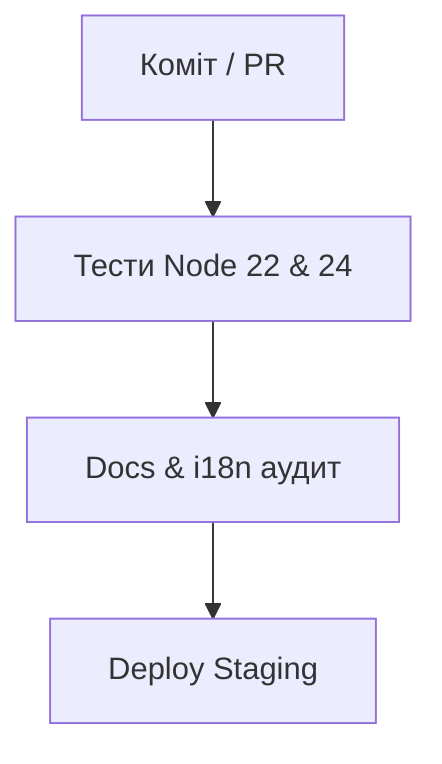
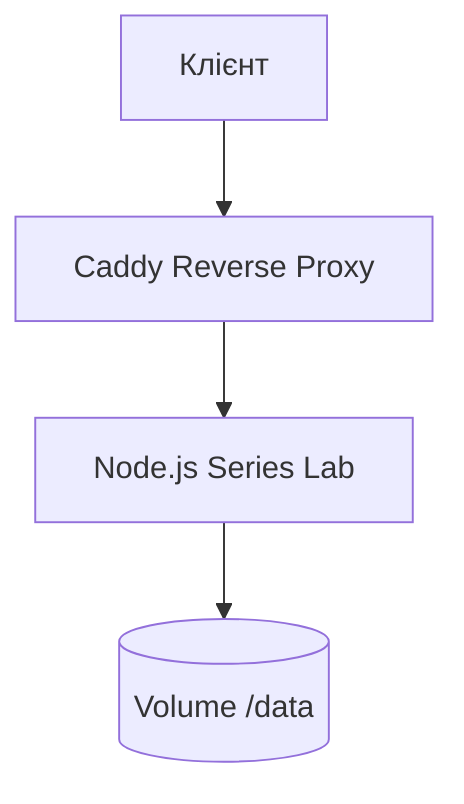

# РОЗДІЛ 4. ТЕСТУВАННЯ, РОЗГОРТАННЯ Й ЕКСПЛУАТАЦІЯ

## 4.1 Стратегія тестування

Тести запускає вбудований виконавець Node.js (`node --test`); зовнішніх тестових фреймворків немає. Набір містить **83 файли і 457 тестів**; на момент складання роботи вони проходять повністю.

| Рівень | Що перевіряє | Приклади файлів |
|---|---|---|
| Модульні (чисті функції) | детермінізм ГПВЧ, унікальність DNA, ваги, рідкість, правила, хвилі, сила референсу | `rng`, `recipes`, `waves-dupes`, `strength`, `wave1`…`wave22` |
| Перевірка архіву | усі правила воріт, 422 при помилках | `preflight`, `phase-b`, `phase-c` |
| Безпека | CSRF/DNS-rebinding, ключі, відхилення секретів, безпечні шляхи, безпечне розпакування ZIP | `guard`, `keys`, `fs-safe-inside`, `layers-zip`, `safety` |
| Платформа й гроші | вхід, кредити, одноразове зарахування, оплата USDC, ціни етапів, маржа | `platform`, `platform-server`, `solpay`, `wallet-rpc`, `stage-pricing`, `margin`, `admin-economy`, `admin-wallet` |
| Дані користувача | видалення даних, анонімізація журналу | `erase`, `delete-data` |
| Випуск | деплой-набір, набір маркетплейсу, `release.json`, Core-потік, генезис-лот | `deploy-kit`, `marketplace-kit`, `release-flow`, `core-flow`, `genesis`, `launch-advisor` |
| Експлуатація | резервні копії, їх перевірка, Docker-образ | `backup`, `backup-db`, `pull-backup`, `verify-backup`, `dockerfile` |
| Інтерфейс і документація | відповідність документації коду, переклади, студійні сторінки | `docs`, `i18n-audit`, `studio-docs`, `legal-pages`, `site` |
| Інтеграційні (справжній сервер) | запуск процесу сервера в тимчасовій теці з двома гаманцями й перевірка HTTP | `platform-server`, `delete-data`, `studio-docs` |

Принципи:

1. **Без мережі й без грошей.** У тестах і smoke-перевірках серверні платні ключі (наприклад, `IRYS_PRIVATE_KEY`) блокуються; рушій `mock` генерує зображення локально.
2. **Тимчасові теки.** Кожен тест працює у власній теці; видалення виконується з повторами (`maxRetries`), оскільки на Windows файл може бути ще зайнятий процесом.
3. **Справжній сервер, де важливо.** Інтеграційні тести запускають `server/index.mjs` як дочірній процес на випадковому порту й завершують його перед очищенням.
4. **Знімок сумісності.** Файл `test/fixtures/compat-snapshot.json` фіксує формати токенів сесії, реферальних кодів, промптів і тарифів, щоб випадкова зміна формату не зламала існуючі сеанси чи посилання.

### Допоміжні аудити

| Команда | Що перевіряє |
|---|---|
| `npm run docs:check` | розбіжності між кодом і документами: 25 CLI-команд, 95 маршрутів, 103 змінні `.env`, індекс 30 документів, версія, видалені постачальники |
| `npm run audit:i18n` | 1752 ключів uk/en збігаються; немає кириличних літералів у коді |
| `npm run audit:ui` | кожен `id`, згаданий у коді, є в HTML |
| `npm run audit:api` | узгодженість маршрутів і документації API |
| `npm run smoke:stage` | наскрізний прогін етапів без платних викликів |

## 4.2 Безперервна інтеграція

**Стан на 10.10.2026.** Тестовий робочий процес `test.yml` на GitHub вилучено: ту саму перевірку (тести, `docs:check`, `audit:i18n`, `audit:ui`, `audit:api`) виконує команда `npm run ci` на комп'ютері розробника, а хук `pre-push` запускає її перед кожним `push`. На GitHub лишились `deploy-site.yml` (публікація сайту) і `health.yml` (зовнішній моніторинг). Нижче описано конвеєр станом на 05.10.2026, як його було випробувано (рис. 4.1).

Конвеєр GitHub Actions (`.github/workflows/test.yml`) запускається на кожному `push` і `pull_request`:

- матриця Node **22** (мінімальна підтримувана версія) і **24** (версія Docker-образу);
- `fail-fast: false`, права лише на читання вмісту;
- скасування застарілих запусків тієї самої гілки (`concurrency`);
- додатковий робочий процес `deploy-site.yml` повторно запускає тести перед публікацією статичного сайту;
- робочий процес `health.yml` кожні 15 хвилин надсилає читальні запити (GET/HEAD) до публічних адрес як **зовнішній** моніторинг: мертвий хост видно, навіть якщо його власні cron і сповіщення не працюють.

Процес роботи з кодом: гілка від `main`, коміти українською у стилі `fix:`/`feat:`/`docs:`, злиття через pull request лише після зелених перевірок. Хук `.githooks/pre-commit` вимагає, щоб коміт із змінами в `src/`, `server/`, `bin/`, `scripts/` чи `package.json` містив також оновлені документи й `CHANGELOG.md`.

Схему конвеєра безперервної інтеграції (CI/CD) на базі GitHub Actions представлено на рис. 4.1.

## 4.3 Контейнеризація й розгортання

**Образ** (`Dockerfile`): основа `node:24-alpine`; `npm ci --omit=dev`; копіюються лише потрібні каталоги (`bin`, `src`, `server`, `schemas`, `presets`, `templates`, `scripts` частково). Контейнер працює від користувача з uid 1000. Хост, домен входу й перелік дозволених хостів **не вшиваються в образ**: без `SERIES_ALLOWED_HOSTS` і `AUTH_DOMAIN` процес завершується з поясненням.

**Оркестрація** (`deploy/series-lab/docker-compose.yml`): сервіс `serieslab`, том даних `/data` (`users.db`, теки гаманців, малі JSON), логування `json-file` з обмеженням 10 МБ × 3 файли, власні секрети у `.env.series-lab`.

**Зворотний проксі:** Caddy (`Caddyfile.staging`) термінує TLS і проксує на `serieslab:5344`; старе ім'я хоста переспрямовується на нове (302). Публічний сервіс працює на `lab.w3ir.io`; статичний лендінг — окремо (Cloudflare Pages).

**Режими:** `SERIES_MODE=public` (образ задає також `HOST=0.0.0.0`, `PORT=5344`, `SERIES_DATA_DIR=/data`) для хоста; `SERIES_MODE=local` лише для ПК.

**Скрипти розгортання:** `phase3.sh` (початкове розгортання staging, ім'я сервісу задається `SERVICE_HOST`), `phase3-rollback.sh` (відкат), `reset-staging.sh`, `upload.sh`.

Схему архітектури розгортання веб-сервісу та проксування трафіку в Docker-середовищі наведено на рис. 4.2.

## 4.4 Резервне копіювання й відновлення

Принцип: «копія, яку ніхто не пробував відкрити, не є бекапом».

| Коли (UTC) | Що | Зберігання |
|---|---|---|
| щогодини | узгоджена копія `users.db` (онлайн-копія SQLite, потім `PRAGMA integrity_check`) | 48 копій |
| щодня 03:15 | повний знімок даних Lab | 7 добових і 4 тижневих |
| кожні 6 год | перевірка свіжості найновішої копії (не старша за 3 год) | — |
| кожні 6 год | перевірка заповнення диска (поріг 80 %), сповіщення в Telegram | — |
| щонеділі | **навчання відновленням**: копія відкривається, `integrity_check` ок, є таблиці `users`, `payments`, `transactions`, `wallet_nonces` | — |

Додатково:

- `npm run backup:pull` на ПК оператора забирає найновішу погодинну копію з сервера по SSH (без ключів хмари), перевіряє її й лишає останні N копій; видаляє супутні файли `-shm/-wal` разом зі старими копіями.
- Скрипт `setup-offsite.sh` готує зашифровану (AES-256-CBC, PBKDF2) копію в S3-сумісне сховище; на момент складання роботи цей крок **ще не ввімкнено** (відкрите завдання експлуатації).

## 4.5 Контроль якості документації

Документація вважається частиною коду: коміт, що змінює поведінку без оновлення документів, не приймається. Відповідність перевіряє `scripts/check-docs.mjs` (також запускається в `npm test`):

- кожна CLI-команда з `series --help` згадана в README або GUIDE;
- кожен HTTP-маршрут з `server/index.mjs` є в `docs/API.md`;
- кожна змінна з `.env.example` описана;
- кожен файл у `docs/` є в індексі `docs/README.md`;
- версія в `package.json` збігається з рядком «Стан» в індексі;
- видалений постачальник (Pinata) не зустрічається в живих документах.

Скрипт не оцінює зміст: правдивість тексту лишається на авторі коміту. У цій роботі додатково проведено аудит покриття підказок і довідки: з 184 видимих елементів керування підказки є майже в усіх; прогалини (близько двох десятків) закрито, до довідки додано всі 24 CLI-команди й три нові запитання FAQ.

## 4.6 Результати перевірки

| Показник | Результат |
|---|---|
| Автотести | 457 з 457 проходять (10.10.2026, `npm run ci`, Node 24) |
| Узгодженість документів | `docs:check` без помилок |
| Переклади | 1752 ключів, uk і en збігаються |
| Інтерфейс | відсутніх елементів немає |
| Підказки | за оцінкою скрипту аудиту станом на 05.10.2026 підказку має 182 з 184 елементів; два залишки — хибні спрацювання (прихований вибір файлу; перемикач, що має підказку на підписі); нові елементи (панель якості, розмір файлів, пробний прогін, кнопка 1/1) мають підказки |
| Відомі ризики | залежність `bigint-buffer` (рівень high, виправлення відсутнє) через `@solana/spl-token`; наш код `toBigIntLE` не викликає; ризик прийнято й задокументовано; не ввімкнено хмарну копію; тексти Умов не перевірені юристом; повноцінний випуск на mainnet пройдено лише частково |

### Живий тест консистентності базової картинки (08.10.2026)

Мета — перевірити, чи тримає базова картинка ідентичність на серії. Умови: `series render`, база `input/primary.png` (лев-воїн, 1024×1024), сила референсу 0,45, 24 кадри з трьома рисами (шарф, фон, вираз) на двох рушіях — Pollinations Kontext (0,02 $ за кадр) і Kontext Pro на Replicate (0,04 $); разом 48 кадрів без збоїв, витрати 1,44 $ за `out/render-log.jsonl` (ліміт `SERIES_SPEND_CAP_USD=2`).

| Вимір | Pollinations | Kontext Pro |
|---|---|---|
| Схожість до бази (середній хеш), середня | 0,880 | 0,880 |
| Діапазон | 0,813–0,906 | 0,828–0,906 |
| Кадри нижче порогу 0,75 | 0 | 0 |
| Попарна схожість кадрів між собою, середня / мінімум | не рахували | 0,949 / 0,859 |
| Той самий номер кадру на двох рушіях, середня / мінімум | 0,983 / 0,969 | 0,983 / 0,969 |

Огляд очима (контактні аркуші й кадри біля обличчя): усі 24 кадри читаються як той самий лев, ідентичність на серії тримається. Від бази відходять камера (далі), грива (світліша, м'якша) і шрам на щоці (то є, то майже зникає). Шарф і вираз «Roaring» дотримані, фони «Teal» і «Dusk» майже не відрізняються від темно-сірого.

Тест виявив три дефекти системи; перші два виправлено:

1. **JPEG під іменем `.png`.** Усі 24 файли Pollinations починалися з `ffd8ff`, а порівняння з базою падало з помилкою «not a png». Виправлено нормалізацією формату виходу рушіїв і командою `series repair-png` (розділ 3.3).
2. **Слабка метрика схожості.** Запас між «своїми» (0,813–0,906) і «чужими» (0,313–0,797) кадрами середнього хеша становив лише 0,016, а поріг 0,75 стояв нижче найвищого чужого значення. Метрика замінена на гістограми напрямів країв: свої кадри 0,771–0,814, чужа серія 0,616–0,687, запас 0,084 (розділ 3.4).
3. **Два рушії не незалежні.** Той самий кадр на Pollinations і Kontext Pro має схожість 0,983: схоже, що під назвою «Pollinations Kontext» працює та сама модель (висновок із метрики, не з документації постачальника). Для порівняння рушіїв потрібен тест на справді різних моделях; це лишається відкритим пунктом.

Обмеження: метрика не розпізнає обличчя (дзеркальна копія бази оцінюється як сама база), а поріг відкалібровано на одній базі й 24 чужих кадрах однієї серії. Знімки тесту лежать у `docs/design-audit/consistency-2026-10-08/`.

### Живий тест сили референсу на fal (09.10.2026)

Мета — перевірити відображення сили референсу для fal (`src/reference.mjs`) і те, чи слухаються риси (шарф, фон, вираз). Умови: `series render`, рушій fal, 8 кадрів з однаковим seed і рисами на п'яти значеннях сили, база `input/primary.png`; потім 4 кадри на новій базі без яскравого шарфа. Загальна вартість близько $1,3. Дотримання рис оцінено на око за контактними аркушами.

| Сила студії | Денойз fal | Схожість до бази | Риси |
|---|---|---|---|
| 0,7 | ≈ 0,53 | 0,806–0,832 | майже не спрацьовують |
| 0,45 | ≈ 0,70 | 0,762–0,803 | майже не спрацьовують, навіть із сильнішими формулюваннями |
| 0,35 | ≈ 0,78 | 0,740–0,780 | вираз 6 з 8, фон слабко, шарф частково |
| 0,3 | ≈ 0,81 | 0,700–0,778 | вираз 8 з 8, фон Dusk 5 з 5, шарф частково |
| 0,2 | ≈ 0,85 | 0,686–0,788 | риси спрацьовують, стиль зсувається до ілюстрації |

Висновки: напрям відображення підтверджено (вище = ближче до бази); для великих рис корисний діапазон 0,30–0,35, типове 0,45 їх майже не змінює; колір шарфа не перефарбовується повністю, поки база має яскравий шарф; на новій базі (її зроблено на Kontext Pro, бо fal не прибрав шарф) червоний шарф спрацював 3 з 3, фон Teal і колір Gold — ні. Помилку власного плану (порада «сила 0,65–0,75» дала зворотний результат) зафіксовано в `docs/ROADMAP.md`. Обмеження: мала вибірка, одна база, оцінка рис на око. Повторний прогін на новій базі (12 кадрів, 10.10.2026, $0,30): схожість 0,745–0,874, середня 0,820, усі кадри вище порога; зелений шарф 5 з 5, червоний 1 з 3, золотий 0 з 3, фон Teal 0 з 5, Dusk 2 з 6, вираз «спокій» 5 з 5, «рик» 3 з 6. Типове значення сили в коді не змінювалось.

**Живий тест 10.10.2026: рушії, поріг, інші бази, 100 кадрів.** Ті самі 12 рецептів на fal, Kontext Pro і Stability дають між рушіями схожість 0,78–0,79 (різні кадри одного рушія — 0,80–0,87), тож рушії різні; Kontext Pro дотримує риси найкраще. Метрика не бачить дрейфу ідентичності (Stability, кадр без броні мають схожість вище порога). Поріг 0,73 лишено: 40 «своїх» кадрів проходять усі, 3 з 16 «чужих» персонажів проходять (на трьох інших базах — 4 з 72). Kontext Pro дотримав риси на 18 кадрах з 18 на трьох чужих базах. 100 кадрів на Kontext Pro: схожість 0,745–0,863, середня 0,808, нижче порога жодного, дрейфу за номером кадру немає, дублікатів немає; один кадр без броні й тіла (45). Вартість етапів близько $5,7. Рушій «Pollinations Kontext» не перевірявся окремо.
