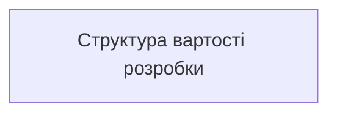
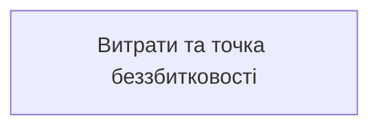

# РОЗДІЛ 5. ЕКОНОМІЧНА ЧАСТИНА. ОХОРОНА ПРАЦІ

Розділ присвячено техніко-економічному обґрунтуванню розробленого програмного комплексу Series Lab, визначенню собівартості розробки, моделі ціноутворення, аналізу окупності та розрахунку точки беззбитковості, а також нормативним вимогам з охорони праці та безпеки життєдіяльності під час розробки та експлуатації веб-системи.

## 5.1 Модель ціноутворення в системі

Користувач бачить **кредити**; долари з'являються на поповненні (USDC у Solana) і в адмін-панелі (собівартість, маржа).

**Пакети кредитів** (за `docs/ECONOMY.md`):

| Пакет | USD | Кредити | $/кредит |
|---|---|---|---|
| Старт | 4,99 | 100 | ≈ 0,050 |
| Креатор | 14,99 | 400 | ≈ 0,038 |
| Профі | 29,99 | 1000 | ≈ 0,030 (найнижча ціна) |

**Правило підлоги.** `кредити = ceil(costUsd × 50)`: один кредит за $0,03 має покривати не менше ніж **1,5×** вартості виклику API. Це гарантує, що найдешевший пакет не продається нижче собівартості з запасом 50 %.

**Тариф рушіїв** (кредитів за кадр: чернетка / фінал / з референсом):

| Сімейство | Кредитів | Типова собівартість API |
|---|---|---|
| Flux (kontext, fal, schnell…) | 1 / 2 / 2–3 | ≈ $0,003–0,04 |
| Stability | 1 / 2 / 2–3 | ≈ $0,03–0,035 |
| OpenAI | 4 / 8 / 6–10 | ≈ $0,04–0,17 |
| Локальний GPU (ComfyUI, A1111) | `LOCAL_GPU_CREDIT_COST` (типово 1) | $0 за API |

**Ціна етапу:**

```
ціна_етапу = собівартість + фіксована_маржа
кредити   = ceil(ціна_етапу / STAGE_USD_PER_CREDIT)       (типово 0,03)
```

Генерація лишається на тарифі рушіїв; евристичний відбір — типово $0; архів, набір деплою й набір маркетплейсу — невеликі фіксовані суми (типово 1–2 кредити). Завантаження в Arweave додається лише тоді, коли користувач запускає його сам (його вартість платить гаманець користувача, а не сервіс).

**Безкоштовний шлях:** рушій `mock` і локальна робота без списань; новий перевірений гаманець отримує 20 вітальних кредитів (разово).

## 5.2 Статті витрат і доходів сервісу

| Стаття | Тип | Як рахується |
|---|---|---|
| Виклики API рушіїв | змінна | сума `costUsd` у `render-log.jsonl` |
| Хостинг (VPS Hetzner) | постійна | ≈ 330 грн/міс ($8) × 12 = 3 960 грн/рік |
| Домен і DNS (Cloudflare) | постійна | ≈ 580 грн/рік ($14/рік) |
| Мережеві комісії | змінна | комісія відправника USDC (копійки) платить користувач; комісія платформи за прийом платежу **відсутня** |
| Сховище копій (S3 / B2) | постійна | ≈ 60 грн/міс ($1,5) × 12 = 720 грн/рік |
| Розробка | одноразова | див. 5.3 (160 000 грн) |
| Дохід | змінна | кредити × $/кредит за проданими пакетами |
| Валова маржа | | дохід − собівартість API |

Модель у коді: `src/platform/margin.mjs` і `scripts/econ-check.mjs` перевіряють юніт-економіку; адмін-вкладка «Економіка» показує за 7 днів, 30 днів і за весь час: операції, собівартість, виручку, різницю по етапах.

## 5.3 Оцінка трудомісткості розробки

Дані комітів: 117 за 13 днів (23.09–05.10.2026), 25 функціональних «хвиль», 10 релізів у `CHANGELOG.md` (від 1.0.0 до 1.8.0).

Фактичний календар робіт у репозиторію (не наказ закладу):

| Етап | Термін | Що закрито |
|---|---|---|
| Ядро майстерні, хвилі 1–25 | 23.09.2026 – 25.09.2026 | рецепти, генерація, відбір, архів |
| Рекомендації й огляд якості | 26.09.2026 | сила референсу, Core Candy Machine, ворота архіву |
| Шлях випуску й Arweave | до 04.10.2026 | v1.7.0: upload, guards, verify |
| Публічний хост | 04.10.2026 | v1.8.0: вхід, USDC, бекапи |
| Genesis, шари, Умови, «Мої дані» | 05.10.2026 | незарелізні зміни після тега 1.8.0 |

Розрахунок вартості розробки за формулою:

```
Вартість розробки = Σ (години_і × ставка) + накладні
```

| Етап | Години | Ставка, грн/год | Сума, грн |
|---|---|---|---|
| Аналіз і проєктування | 60 | 400 | 24 000 |
| Реалізація ядра | 80 | 400 | 32 000 |
| Реалізація сервера й UI | 100 | 400 | 40 000 |
| Платформа й оплата | 60 | 400 | 24 000 |
| Тестування й CI | 50 | 400 | 20 000 |
| Документація | 50 | 400 | 20 000 |
| Разом | 400 | 400 | 160 000 |

Структуру вартості розробки наведено на рис. 5.1.



**Рисунок 5.1 — Структура вартості розробки Series Lab (160 000 грн).**

Окремо відзначимо, що завдяки використанню ШІ-асистента для рутинних операцій кодогенерації й верстки зекономлено приблизно 35–40 % часу (див. декларацію, файл 12), що суттєво скоротило календарні терміни реалізації проєкту.

## 5.4 Окупність

```
Точка беззбитковості (кредитів) = (Постійні витрати за період) / (Ціна кредиту − Собівартість кредиту)
```

Для найдешевшого пакета «Профі»: ціна кредиту ≈ $0,03; для Flux-рушіїв собівартість кадру ≈ $0,003–0,04 за 1–3 кредити, тобто маржа на кредит додатна лише завдяки правилу підлоги ×1,5. При постійних витратах сервісу на інфраструктуру близько 5 260 грн/рік (≈ $128/рік або ≈ $11/міс) точка беззбитковості досягається вже при продажу 1–2 пакетів «Профі» або 3–4 пакетів «Креатор» на місяць.

Графік постійних витрат і орієнтовної точки беззбитковості за пакетами наведено на рис. 5.2.



**Рисунок 5.2 — Постійні витрати інфраструктури та точка беззбитковості за пакетами.**

## 5.5 Охорона праці та безпека в надзвичайних ситуаціях

Робота програміста й користувача Series Lab належить до праці з візуальним дисплейним терміналом. Норми нижче взято з ДСанПіН 3.3.2.007-98 [28].

1. **Умови праці за ВДТ.** Освітленість поверхні столу в зоні документів — 300–500 лк; освітленість екрана не перевищує 300 лк, без відблисків (п. 3.2.3). Коефіцієнт природної освітленості — не нижче 1,5 % (п. 2.5). Екран розташовують на відстані 600–700 мм від очей і не ближче ніж 600 мм (п. 4.14). Для програмістів еквівалентний рівень звуку — 50 дБА (додаток 1). Джерела шуму (принтери) виносять з приміщення роботи за ВДТ (п. 3.3.2).
2. **Режим праці.** Для розробників програм регламентована перерва — 15 хвилин через кожну годину роботи за ВДТ (п. 5.8). Якщо виробничі обставини не дають застосувати такі перерви, безперервна робота з ВДТ не перевищує 4 годин (п. 5.9).
3. **Ергономіка інтерфейсу.** Шлях майстерні поділено на кроки, підказки з'являються при наведенні, довідка є українською й англійською, верстка лишається придатною на вузькому екрані. Небезпечна дія підтверджується: видалення даних вимагає слова `DELETE`, видалений кадр можна повернути з кошика.
4. **Електробезпека й пожежна безпека.** Несправний блок живлення і пошкоджений кабель не експлуатують. Корпуси обладнання заземлюють. У приміщенні є первинні засоби пожежогасіння і відомий шлях евакуації.
5. **Надзвичайні ситуації.** При зникненні електроживлення або зв'язку роботу з незаписаним станом припиняють після збереження пресету. Для сервісу відновлення після збою обладнання дають погодинні копії бази й перевірка `integrity_check` (розділ 4.4).
6. **Інформаційна безпека.** Приватний ключ не залишає ПК користувача. Сервер відхиляє тіла запитів із полями ключа, пароля чи seed-фрази. Сесія обмежена в часі.

## 5.6 Висновки до розділу

Ціноутворення в системі побудовано так, щоб жоден платний виклик не міг бути продано дешевше за 1,5× собівартості API; безкоштовний шлях (`mock`, локальний GPU) доступний без витрат. Норми робочого місця за ВДТ взято з ДСанПіН 3.3.2.007-98. Розрахована вартість розробки програмного продукту становить 160 000 грн при річних постійних витратах на хмарну інфраструктуру близько 5 260 грн, що підтверджує високу економічну ефективність та швидку окупність системи (рис. 5.1, 5.2).
