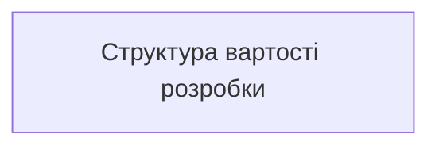
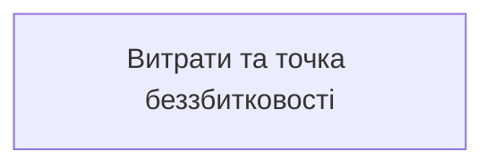

# РОЗДІЛ 5. ЕКОНОМІЧНА ЧАСТИНА. ОХОРОНА ПРАЦІ

Розділ присвячено техніко-економічному обґрунтуванню розробленого програмного комплексу Series Lab, визначенню собівартості розробки, моделі ціноутворення, аналізу окупності та розрахунку точки беззбитковості, а також нормативним вимогам з охорони праці та безпеки життєдіяльності під час розробки та експлуатації веб-системи.

## 5.1 Модель ціноутворення в системі

Користувач бачить **кредити**; долари з'являються на поповненні (USDC у Solana) і в адмін-панелі (собівартість, маржа).

**Пакети кредитів** (за `docs/ECONOMY.md`):

| Пакет | USD | Кредити | $/кредит |
|---|---|---|---|
| Старт | 4,99 | 100 | ≈ 0,050 |
| Креатор | 14,99 | 400 | ≈ 0,038 |
| Профі | 29,99 | 1000 | ≈ 0,030 (найнижча ціна) |

**Правило підлоги.** `кредити = ceil(costUsd × 50)`: один кредит за $0,03 має покривати не менше ніж **1,5×** вартості виклику API. Це гарантує, що найдешевший пакет не продається нижче собівартості з запасом 50 %.

**Тариф рушіїв** (кредитів за кадр: чернетка / фінал / з референсом):

| Сімейство | Кредитів | Типова собівартість API |
|---|---|---|
| Flux (fal, schnell, runware, Pollinations…) | 1 / 2 / 2–3 | ≈ $0,003–0,025 |
| Kontext Pro (Replicate, 0,04 $) | мінімум 3 | 0,04 $ |
| Stability | 1 / 2 / 2–3 | ≈ $0,03–0,035 |
| OpenAI | 4 / 8 / 6–10 | ≈ $0,04–0,17 |
| Локальний GPU (ComfyUI, A1111) | `LOCAL_GPU_CREDIT_COST` (типово 1) | $0 за API |

**Ціна етапу:**

```
ціна_етапу = собівартість + фіксована_маржа
кредити   = ceil(ціна_етапу / STAGE_USD_PER_CREDIT)       (типово 0,03)
```

Генерація лишається на тарифі рушіїв; евристичний відбір — типово $0; архів, набір деплою й набір маркетплейсу — невеликі фіксовані суми (типово 1–2 кредити). Завантаження в Arweave додається лише тоді, коли користувач запускає його сам (його вартість платить гаманець користувача, а не сервіс).

**Безкоштовний шлях:** рушій `mock` і локальна робота без списань; новий перевірений гаманець отримує 20 вітальних кредитів (разово).

## 5.2 Статті витрат і доходів сервісу

| Стаття | Тип | Як рахується |
|---|---|---|
| Виклики API рушіїв | змінна | сума `costUsd` у `render-log.jsonl` |
| Хостинг (VPS Hetzner, спільний хост) | постійна | ≈ 330 грн/міс ($8) × 12 = 3 960 грн/рік |
| Буфер Irys / RPC / DNS (домен ≈ $14/рік входить сюди) | постійна | ≈ 413 грн/міс ($10) × 12 = 4 950 грн/рік |
| Мережеві комісії | змінна | комісія відправника USDC (копійки) платить користувач; комісія платформи за прийом платежу **відсутня** |
| Зовнішня копія (Cloudflare R2) | постійна | 0 грн: безкоштовні 10 ГБ на місяць, наші копії менше 1 ГБ; до 10.10.2026 копії лежали в Hetzner Object Storage за до $7,99 на місяць (до 3 960 грн/рік), тому їх перенесено |
| Розробка | одноразова | див. 5.3 (160 000 грн) |
| Дохід | змінна | кредити × $/кредит за проданими пакетами |
| Валова маржа | | дохід − собівартість API |

Модель у коді: `src/platform/margin.mjs` і `scripts/econ-check.mjs` перевіряють юніт-економіку; адмін-вкладка «Економіка» показує за 7 днів, 30 днів і за весь час: операції, собівартість, виручку, різницю по етапах.

## 5.3 Оцінка трудомісткості розробки

Дані комітів: 199 за 18 днів (23.09–10.10.2026), 27 функціональних «хвиль», 12 релізів у `CHANGELOG.md` (від 1.0.0 до 1.10.0).

Фактичний календар робіт у репозиторію (не наказ закладу):

| Етап | Термін | Що закрито |
|---|---|---|
| Ядро майстерні, хвилі 1–25 | 23.09.2026 – 25.09.2026 | рецепти, генерація, відбір, архів |
| Рекомендації й огляд якості | 26.09.2026 | сила референсу, Core Candy Machine, ворота архіву |
| Шлях випуску й Arweave | до 04.10.2026 | v1.7.0: upload, guards, verify |
| Публічний хост | 04.10.2026 | v1.8.0: вхід, USDC, бекапи |
| Genesis, шари, Умови, «Мої дані» | 05.10.2026 | випуск 1.9.0 |
| Якість серії, стиснення до 1 МБ, перевірка провенансу, `series repair-png`, необов'язковий пробний прогін, рівні 1/1, людський внесок, шаблони ліцензії власника | 06.10.2026 – 09.10.2026 | випуск 1.9.0 |
| Позначка ШІ й C2PA, CSP, власні бібліотеки замість CDN, гібридні шари, вкладка адмінки «Система», доступність | 09.10.2026 – 10.10.2026 | випуск 1.10.0 |

Розрахунок вартості розробки за формулою:

```
Вартість розробки = Σ (години_і × ставка) + накладні
```

| Етап | Години | Ставка, грн/год | Сума, грн |
|---|---|---|---|
| Аналіз і проєктування | 60 | 400 | 24 000 |
| Реалізація ядра | 80 | 400 | 32 000 |
| Реалізація сервера й UI | 100 | 400 | 40 000 |
| Платформа й оплата | 60 | 400 | 24 000 |
| Тестування й CI | 50 | 400 | 20 000 |
| Документація | 50 | 400 | 20 000 |
| Разом | 400 | 400 | 160 000 |

Структуру вартості розробки наведено на рис. 5.1.



**Рисунок 5.1 — Структура вартості розробки Series Lab (160 000 грн).**

Окремо відзначимо, що завдяки використанню ШІ-асистента для рутинних операцій кодогенерації й верстки зекономлено приблизно 35–40 % часу (див. декларацію, файл 12), що суттєво скоротило календарні терміни реалізації проєкту.

## 5.4 Окупність і критичний аналіз

Цей підрозділ відповідає на два запитання: за яких продажів сервіс покриває власні витрати (юніт-економіка) і чи є докази, що такі продажі можливі (попит). На першу відповідь дає модель у коді, на другу лише експлуатація, і вона поки що не підтверджує очікувань.

### 5.4.1 Беззбитковість за моделлю

```
Точка беззбитковості (пакетів на місяць) = Постійні витрати на місяць / Внесок одного пакета
Внесок пакета = Ціна × (1 − комісія входу) − Кредити × Собівартість кредиту × (1 + комісія виходу)
```

Припущення моделі (`src/platform/margin.mjs`, `scripts/econ-check.mjs`): постійні витрати 18 $ на місяць (VPS 8 $ і буфер Irys / RPC / DNS 10 $, у якому міститься домен; зовнішня копія на Cloudflare R2 безкоштовна в межах 10 ГБ), комісія платформи за прийом платежу 0 %, обмін USDC у долари на вході 2 % і на виході для оплати API та інфраструктури 2 %, змішана собівартість кредиту 0,0105 $ (70 % Flux, 15 % OpenAI, 15 % локальний GPU).

| Пакет | Внесок пакета, $ | Беззбитковість, пакетів на місяць |
|---|---|---|
| Старт (4,99 $, 100 кр) | 3,82 | 5 |
| Креатор (14,99 $, 400 кр) | 10,41 | 2 |
| Профі (29,99 $, 1000 кр) | 18,68 | 1 |

Графік постійних витрат і орієнтовної точки беззбитковості за пакетами наведено на рис. 5.2.



**Рисунок 5.2 — Постійні витрати інфраструктури та точка беззбитковості за пакетами.**

**Чутливість до складу рушіїв.** Змішана собівартість є припущенням, а не виміром: структура рушіїв реальних платників невідома. Нижче те саме при інших значеннях собівартості кредиту.

| Сценарій | Собівартість кредиту, $ | Старт | Креатор | Профі |
|---|---|---|---|---|
| Змішана (модель) | 0,0105 | 5 | 2 | 1 |
| Лише Kontext Pro (3 кр за кадр, API 0,04 $) | 0,0133 | 6 | 2 | 2 |
| Лише OpenAI фінал (8 кр, API 0,167 $) | 0,0209 | 7 | 3 | 3 |
| Змішана, але платне сховище копій 7,99 $/міс (фікс 26 $) | 0,0105 | 7 | 3 | 2 |

Останній рядок показує, чому зовнішню копію перенесено з Hetzner Object Storage на безкоштовний рівень Cloudflare R2: платне сховище з'їдало б близько третини постійних витрат (приблизно два додаткові продажі «Старт» на місяць) без жодного доходу.

### 5.4.2 Окупність розробки

Вартість розробки 160 000 грн (підрозділ 5.3) становить близько 3 880 $ за курсом 41,25 грн/$. Чистий місячний прибуток за моделлю та відповідний термін повернення розробки:

| Продажі на місяць | Чистий прибуток, $/міс | Термін повернення розробки |
|---|---|---|
| 5 пакетів «Профі» | 75 | ≈ 52 міс |
| 10 пакетів «Профі» | 168 | ≈ 23 міс |
| 20 пакетів «Профі» | 355 | ≈ 11 міс |
| 40 пакетів «Профі» | 729 | ≈ 5 міс |

Тобто лише розробка окупається приблизно за 200 проданих пакетів «Профі» (або близько 1 000 пакетів «Старт»). Модель не містить трьох статей, які на практиці вирішальні:

1. **Вартість залучення клієнта.** Якщо покупець приходить через рекламу, перша покупка «Старт» дає лише 3,82 $ внеску, тож залучення дорожче за 3,82 $ означає збиток на першій покупці й окупність лише за умови повторних покупок.
2. **Податки.** Виручка надходить в USDC безпосередньо власнику; податковий режим для цієї діяльності не опрацьовано, а чиста маржа в моделі рахується до оподаткування.
3. **Час на підтримку, маркетинг і розвиток** не оцінено в гривнях.

### 5.4.3 Що показала експлуатація (стан на 10.10.2026)

Дані взято з бази платформи публічного хоста (запити лише на читання).

| Показник | Значення |
|---|---|
| Користувачів / з них внутрішніх (оператор, адмін, dogfood) | 33 / 3 |
| Платежів усього; сума | 14; 89,86 $ |
| Платежі внутрішніх гаманців | 74,89 $ (83 %) |
| Платежі зовнішніх платників | 3 платники по 4,99 $ (пакет «Старт») = 14,97 $, **жодного повтору** |
| З них через пряму оплату USDC, запущену 4.10.2026 | 1 платіж (4,99 $); решта 9 платежів із 14 надійшли ще через попередній провайдер |
| Споживання кредитів зовнішніми користувачами | 267 із 3096 списаних (8,6 %) |
| Безкоштовні кредити (вітальні й видані вручну) проти оплачених | 2505 проти 2000 (56 % випущених) |
| Відмови у вітальних кредитах (порожній гаманець) | 29 подій, але лише 2 унікальні зовнішні гаманці (один пізніше отримав кредити): відсіву нових користувачів немає |
| Баланси на провайдерах API (10.10.2026) | ≈ 124 $ (OpenAI 30,94; Anthropic 19,05; Stability 39,35; Replicate 6,66; fal 23,09; Pollinations ≈ 5,3) проти рекомендованих 30 $ за навантаженням користувачів; автопоповнення вимкнене в усіх, тож вичерпання балансу зупинило б генерацію без попередження |
| Витрати за кабінетом провайдера проти журналу кредитів | Replicate: 8,08 $ за жовтень і 20,87 $ за вересень проти 0,48 $ оцінки журналу за 30 днів; різниця це оплачені з ключів тести рушіїв і розробка, які в журнал кредитів не потрапляють |
| Реєстрації за місяць | червень 6, липень 1, серпень 18, вересень 7, жовтень 1 (місяць не завершено) |

**Висновок.** Платежі власної команди є переказом самому собі й доходом не є, тому адмін-панель окремо показує «Чистий без внутрішніх платежів». За зовнішніми платниками дохід за всю історію становить 14,97 $ проти постійних витрат близько 18 $ на місяць, тобто сервіс сьогодні збитковий, а джерелом покриття є власник. Вибірка мала (три платники, один із них у новій платіжній системі), тому вона не доводить відсутність попиту, але й попиту не доводить.

### 5.4.4 Рішення на основі даних

1. **Правило рішення.** Протягом 90 днів від 10.10.2026 (до 08.01.2027): не менше 10 зовнішніх платників і не менше 2 повторних покупок означають, що інвестиції в розвиток виправдані; інакше сервіс переводиться в режим мінімальних витрат. Правило виконано в коді (`src/platform/decision.mjs`): прогрес видно в адмінці «Економіка», а щопонеділка в Telegram приходить звіт із трьома числами за тиждень (платники, повторні покупки, дохід зовнішніх).
2. **Упаковка за результатом.** Користувач, який має власний ключ API, може згенерувати серію локально за собівартість API. Тому платним стає не рендер, а шлях випуску: відбір, провенанс, позначка ШІ, пакет деплою й експорт; ціну варто прив'язувати до результату («серія з N кадрів»).
3. **Маржа на рекомендованому рушії.** Kontext Pro дотримує риси найкраще, але коштував 2 кредити (валова маржа 33 % на найдешевшому пакеті); тариф підвищено до 3 кредитів (маржа ≈ 56 %), інші Flux-рушії лишаються по 2.
4. **Облікова гігієна.** Панель показує чистий прибуток без внутрішніх платежів; постійні витрати в моделі відповідають фактичним (18 $ на місяць).

## 5.5 Охорона праці та безпека в надзвичайних ситуаціях

Робота програміста й користувача Series Lab належить до праці з візуальним дисплейним терміналом. Норми нижче взято з ДСанПіН 3.3.2.007-98 [28].

1. **Умови праці за ВДТ.** Освітленість поверхні столу в зоні документів — 300–500 лк; освітленість екрана не перевищує 300 лк, без відблисків (п. 3.2.3). Коефіцієнт природної освітленості — не нижче 1,5 % (п. 2.5). Екран розташовують на відстані 600–700 мм від очей і не ближче ніж 600 мм (п. 4.14). Для програмістів еквівалентний рівень звуку — 50 дБА (додаток 1). Джерела шуму (принтери) виносять з приміщення роботи за ВДТ (п. 3.3.2).
2. **Режим праці.** Для розробників програм регламентована перерва — 15 хвилин через кожну годину роботи за ВДТ (п. 5.8). Якщо виробничі обставини не дають застосувати такі перерви, безперервна робота з ВДТ не перевищує 4 годин (п. 5.9).
3. **Ергономіка інтерфейсу.** Шлях майстерні поділено на кроки, підказки з'являються при наведенні, довідка є українською й англійською, верстка лишається придатною на вузькому екрані. Небезпечна дія підтверджується: видалення даних вимагає слова `DELETE`, видалений кадр можна повернути з кошика.
4. **Електробезпека й пожежна безпека.** Несправний блок живлення і пошкоджений кабель не експлуатують. Корпуси обладнання заземлюють. У приміщенні є первинні засоби пожежогасіння і відомий шлях евакуації.
5. **Надзвичайні ситуації.** При зникненні електроживлення або зв'язку роботу з незаписаним станом припиняють після збереження пресету. Для сервісу відновлення після збою обладнання дають погодинні копії бази й перевірка `integrity_check` (розділ 4.4).
6. **Інформаційна безпека.** Приватний ключ не залишає ПК користувача. Сервер відхиляє тіла запитів із полями ключа, пароля чи seed-фрази. Сесія обмежена в часі.

## 5.6 Висновки до розділу

Ціноутворення в системі побудовано так, щоб жоден платний виклик не міг бути продано дешевше за 1,5× собівартості API; безкоштовний шлях (`mock`, локальний GPU) доступний без витрат. Норми робочого місця за ВДТ взято з ДСанПіН 3.3.2.007-98. Розрахована вартість розробки програмного продукту становить 160 000 грн при річних постійних витратах на інфраструктуру близько 8 900 грн (18 $ на місяць). Юніт-економіка здорова: за моделлю беззбитковість досягається приблизно за 5 пакетів «Старт» або 1–2 пакети «Профі» на місяць, а сама розробка окупається приблизно за 200 пакетів «Профі». Проте експлуатація поки що не підтверджує попиту: за всю історію зовнішні платники принесли 14,97 $ без жодного повтору, тож економічна ефективність сервісу залежить від доведення попиту, а не від собівартості (підрозділ 5.4, рис. 5.1, 5.2).
