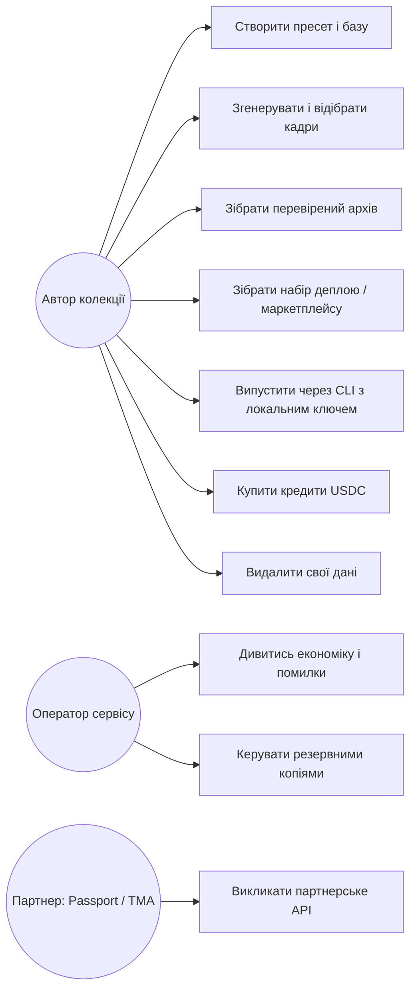
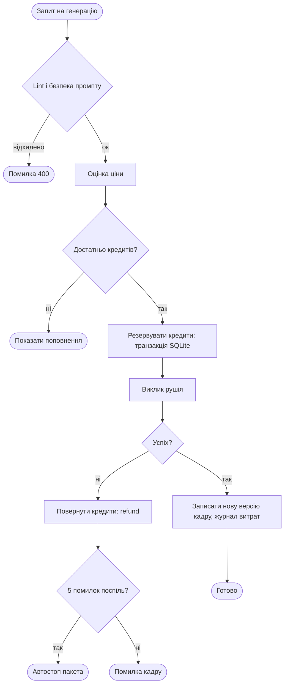
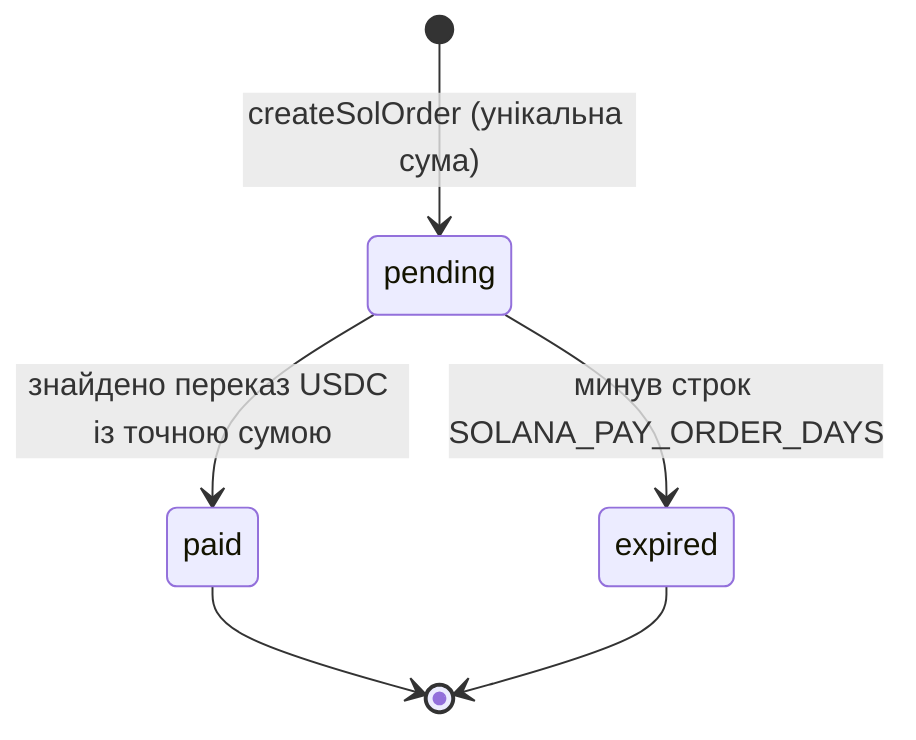
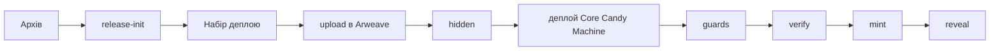

# ДОДАТКИ

## Додаток А. Технічне завдання

**1. Загальні відомості.** Повна назва: «Series Lab — веб-система створення, перевірки й підготовки до випуску колекцій NFT». Умовне позначення: Series Lab. Версія документа відповідає версії системи 1.8.0.

**2. Призначення й цілі.** Система призначена для авторів колекцій цифрових активів, що потребують відтворюваного набору унікальних зображень, перевіреного архіву та набору для випуску в мережі Solana. Цілі: (1) єдиний шлях від базової картинки до набору випуску; (2) відтворюваність і унікальність; (3) блокування некоректного архіву; (4) відсутність приватних ключів на сервері; (5) публічний режим з оплатою USDC.

**3. Вимоги до системи.** Функціональні й нефункціональні вимоги наведені в розділі 2.1 (ФВ-1…ФВ-14, НВ-1…НВ-9).

**4. Вимоги до програмного забезпечення.** Node.js ≥ 22.13; ОС Windows 10/11 або Linux; браузер із підтримкою ES-модулів; для розгортання — Docker; для зворотного проксі — Caddy або еквівалент.

**5. Вимоги до безпеки.** Приватні ключі не приймаються й не зберігаються; вхід підписом гаманця; захист від CSRF і DNS-rebinding; одноразове зарахування платежів; обмеження частоти; резервне копіювання з перевіркою відновлення.

**6. Вимоги до документації.** Українська й англійська довідка в інтерфейсі; посібники користувача й адміністратора; технічна документація в `docs/`, що відповідає коду (автоматична перевірка).

**7. Стадії й етапи.** Аналіз → проєктування → реалізація → тестування → розгортання → супровід. Критерії приймання: усі автоматичні тести проходять; `docs:check`, `audit:i18n`, `audit:ui` без помилок; пройдено програму випробувань (файл 15).

**8. Порядок контролю й приймання.** Згідно з документом «Програма та методика випробувань».

## Додаток Б. Діаграми

### Б.1 Діаграма варіантів використання



### Б.2 Діаграма активностей: генерація кадру з резервуванням кредитів



### Б.3 Стани замовлення на оплату



### Б.4 Шлях випуску



## Додаток В. HTTP-API (за `docs/API.md`)

Нижче перелічено таблиці маршрутів без змін. Актуальний перелік потрібно брати з `docs/API.md` (його узгодженість із кодом перевіряє `npm run docs:check`).

**Health / resources**

| Method | Path | Опис |
|--------|------|------|
| GET | `/api/health` | ok, product, port, base status, keysFile path, engines |
| GET | `/api/resources` | наявність ключів (presence only) |

**Presets / templates / trait packs**

| Method | Path | Опис |
|--------|------|------|
| GET | `/api/presets` | список пресетів |
| GET | `/api/preset?file=` | повний пресет |
| POST | `/api/validate` | body `{ file }` або `{ preset }` |
| POST | `/api/preset/save` | записати `presets/<id>.json` |
| GET | `/api/templates` | список шаблонів |
| GET | `/api/templates/:id` | шаблон як пресет |
| GET | `/api/trait-packs` | список паків (`libraries/traits/`) |
| GET | `/api/trait-packs/:id` | повний пак + summary |
| POST | `/api/trait-packs/save` | зберегти/створити пак у `libraries/traits/<id>.json` |
| POST | `/api/trait-packs/export-from-preset` | експортувати трейти пресету в окремий пак |

**Recipes / archive / rarity / lint**

| Method | Path | Опис |
|--------|------|------|
| POST | `/api/build` | зібрати архів → `out/<id>.json` |
| POST | `/api/diff-seed` | перевірка стабільності DNA |
| GET | `/api/recipes?file=` | рецепти архіву (+ мета для таблиці) |
| POST | `/api/recipe` | редагувати рецепт (`file`, `index`, `traits`/`note`/`reset`); conflicts → 400 |
| GET | `/api/rarity?file=` | rarity report (очікуваний vs факт) |
| POST | `/api/lint` | `{ text }` або `{ texts: [] }` — lint/blocklist |
| GET | `/api/archive/list` | `out/*.json` |
| GET | `/api/archive/latest` | найновіший архів |
| GET | `/api/archive/file?file=` | download JSON |

**Base images / Vision Assist**

| Method | Path | Опис |
|--------|------|------|
| GET | `/api/base/status` | чи є головна базова |
| GET | `/api/base/list` | файли в `input/` + wish |
| POST | `/api/base/upload` | base64 → role primary/line/style/extra |
| POST | `/api/base/primary` | призначити файл головною базою |
| POST | `/api/base/delete` | видалити файл з `input/` |
| GET | `/api/base/wish` | поточний wish |
| POST | `/api/base/wish` | зберегти wish.json |
| POST | `/api/base/generate` | wish → зображення (lint + txt2img/edit); опційно makePrimary |
| POST | `/api/base/analyze` | AI Vision аналіз базової картинки (styleLock + traits) |

**Generate**

| Method | Path | Опис |
|--------|------|------|
| POST | `/api/estimate` | безкоштовна оцінка: mode, editions, cost, lint |
| POST | `/api/generate` | live generate: batch з архіву або single prompt; SSE стрім + паралелізм (`concurrency`), `mode: "redo"`. Якщо відбір порожній, відповідь — JSON `count: 0` і SSE не відкривається. Закриття з’єднання (кнопка «Зупинити») скасовує решту кадрів; уже записані файли лишаються. |

**Review (sets / marks / triage)**

| Method | Path | Опис |
|--------|------|------|
| GET | `/api/sets` | список наборів у `out/` |
| GET | `/api/set?dir=` | зображення набору + marks + light QA + `shelved` (кадри, прибрані з набору) |
| POST | `/api/set/delete` | `{ dir, edition }` — кадр у кошик |
| POST | `/api/set/drop` | `{ dir, edition }` — прибрати кадр із набору, файл лишається у `versions/` |
| GET | `/api/marks?dir=` | keep/redo marks |
| POST | `/api/marks` | оновити marks (`dir` + `edition`/`mark` або `marks`) |
| POST | `/api/qa/triage` | AI Auto-Triage & Smart Critic (`dir`, `mode`, `provider`, `autoApplyMarks`) |

**Export / checklist / workspace / storage**

| Method | Path | Опис |
|--------|------|------|
| GET | `/api/export/csv?file=` | CSV промптів |
| GET | `/api/export/txt?file=` | TXT промптів |
| POST | `/api/export/bundle` | mint-ready ZIP → `out/bundles/` (ERC-721, Metaplex, Ordinals; опційно `imageUriPrefix`; опційно `authorship`: `{ baseOrigin: hand\|photo\|ai_curated\|ai_raw, handEdited, handLayers, note }` — заява про людський внесок, пишеться в `authorship.json` і README) |
| POST | `/api/export/preview-meta` | генерація попереднього перегляду метаданих `1.json` |
| GET | `/api/checklist` | `?archive=&set=` — NFT readiness items |
| GET | `/api/workspace` | прочитати `workspace/current.json` |
| POST | `/api/workspace` | зберегти / `clear` workspace |
| GET | `/api/storage/status` | статус ключа Arweave (Irys) |
| POST | `/api/storage/pin` | завантаження папки набору в Arweave (Irys) серверним `IRYS_PRIVATE_KEY`; списує кредити етапу «архів»; перед оплатою рахує ціну (ліміт `IRYS_MAX_PRICE_SOL`, типово 0.05 SOL) і поповнює Irys за потреби; віддає `arweaveUri` (`ar://<id>/`). Для випуску в мережу є CLI `series upload` (ключ на ПК) — [RELEASE.md](./RELEASE.md) |
| GET | `/api/launchpads` | список профілів лаунчпадів (OpenSea, Magic Eden Drop (Solana), LaunchMyNFT, Ordinals) |
| GET | `/api/export/manifest.csv` | експорт CSV маніфесту для гуртового імпорту (`?archive=&profile=&zeroIndexed=`) |
| GET | `/api/export/showcase.html` | завантаження автономного HTML візуального пруфу та оцінки рідкості |
| GET | `/api/release/portals` | отримання посилань на лаунчпади та покрокових порад (`?profile=&archive=`) |
| GET | `/api/release/config` | конфіг деплою: типово `cm-config.json` (Core Candy Machine); `sugar.json` лише якщо `?legacy=1`; для EVM — `thirdweb.json` |
| POST | `/api/preflight` | перевірка архіву перед ZIP: помилки блокують, попередження ні |
| POST | `/api/deploy-kit` | ZIP набору деплою. `chain` типово `solana` (Core). `solana-legacy` або `legacy: true` — застарілий Sugar. Поля `holderModel` (як `licence` вище) і `holderCap` обирають чернетку для `HOLDER-LICENCE.txt`; власний текст `holderLicence` має перевагу. Поле `rehearsal` (`devnet` типово, `skip`) лише змінює інструкцію в наборі: при `skip` вона має один розділ для основної мережі, нічого не блокується. Поле `allowlist` (текст, один адрес Solana на рядок) пише `allowlist.json` з merkle root; невалідна адреса — 400. Тіло з приватним ключем — 400 `secrets` |
| GET | `/api/layers/status` | Що лежить у теці шарів гаманця (`layers/`): `{ exists, files, bytes, keys: [{ key, count }], coverage, limits }`. З `?archive=<файл>` додає `coverage` `{ expected, present, missing[≤40], missingCount }`: скільки значень рис серії мають PNG (значення `None` файлу не потребує). |
| POST | `/api/layers/upload` | ZIP із шарами в тілі, `Content-Type: application/zip` (єдиний маршрут, де JSON не обов'язковий). Структура `<риса>/<значення>.png` (до 3 рівнів, обгортка `layers/` знімається). `?clear=1` — спершу замінити все (старі файли йдуть у кошик), `?archive=` — повернути покриття. Перевірки: небезпечні шляхи (`..`, абсолютні, зарезервовані імена) відхиляють весь ZIP, лише справжні PNG (підпис і IHDR, до 8192 px і 40 Мпікс), до 40 МБ ZIP, 1500 файлів, 8 МБ файл, 120 МБ за раз, 200 МБ у теці. Усе або нічого: невдалий ZIP нічого не лишає. Відповідь `{ files, bytes, keys, skipped[], cleared, status }`; помилки з `code: "layers_<причина>"`. |
| POST | `/api/layers/clear` | Переносить усі шари гаманця в кошик (`out/trash`, відновлення в «Ресурсах»): `{ removed, trashId }`. |
| POST | `/api/compose` | Складає PNG-шари архіву в `out/layers`. Тіло: `archive` (або `file`), необов’язково `layers` (тека всередині проєкту; типово тека шарів гаманця, куди кладе `/api/layers/upload`), `base` (ім’я файлу в `input/`), `limit`. Промпти не змінюються. Кредити не списуються. Немає рис, теки шарів чи базової картинки — 400. **Перегляд одного кадру:** `preview` (номер видання) складає лише це видання в пам'яті (з базою чи з `over`) і повертає `mode: "preview"`, `edition`, `layers`, `skipped`, `sha256`, `png` (data URL); нічого не пишеться на диск, кредити не списуються; немає видання чи кадру в наборі — 404, некоректний номер — 400. Порядок накладання шарів задає необов'язкове поле риси `z` у пресеті |
| GET | `/api/launch-advisor?chain=&locale=` | офлайн-порадник. Creator Hub лише для `solana`. Біржових цін немає. Необов'язково `licence` (`statement` типово, `personal`, `commercial`, `commercial_cap`, `cc0`), `name`, `creator`, `cap`: тоді `holderTemplate` — чернетка ліцензії власника цієї моделі; `licenceModels` — перелік моделей |
| POST | `/api/marketplace-kit` | ZIP набору маркетплейсу. Solana: Magic Eden і Tensor. EVM: OpenSea. Bitcoin: Ordinals, без Magic Eden |

**Versions / trash / spend (захист оплачених рендерів)**

| Method | Path | Опис |
|--------|------|------|
| GET | `/api/versions?dir=&edition=` | історія версій картинки: `out/<set>/versions/<N>/` |
| POST | `/api/versions/current` | `{ dir, edition, v }` — зробити версію поточною (`<N>.png`) |
| POST | `/api/versions/drop` | `{ dir, edition, v }` — непоточну версію в кошик |
| POST | `/api/set/delete` | `{ dir, edition }` — поточний кадр, його версії й нотатку створення в кошик; позначку keep/redo знімає |
| POST | `/api/set/drop` | `{ dir, edition }` — прибрати поточний кадр із набору, не знищуючи файл: `<N>.png` стає `versions/<N>/v<k>.png`, `current` = null. Повернути — `POST /api/versions/current` |
| GET | `/api/trash` | записи кошика `out/trash/<id>/` (новіші першими) |
| POST | `/api/trash/restore` | `{ id }` — повернути файли на місце (відмова, якщо ціль уже існує) |
| POST | `/api/account/delete-data` | «Мої дані» (лише публічний режим, потрібен вхід). Тіло `{ "confirm": "DELETE" }` (точне слово, інакше 400 `code: "confirm"`). Видаляє теку гаманця (вхідні, пресети, зображення, шари, кошик, робочу копію), рядки `funnel_events`, `referral_codes`, `wallet_nonces`, `freemium_usage` і замінює гаманець на `"erased"` та прибирає назву серії в `render-log.jsonl`. **Лишає** облік грошей: `users` (баланс), `payments`, `transactions`, `sol_orders`, `referrals`, `holder_grants`. Відповідь `{ ok, filesRemoved, rows, logLines }`. |
| POST | `/api/trash/purge` | `{ id }` — видалити запис назавжди |
| GET | `/api/spend` | `{ capUsd, spentTodayUsd, byEngine }` з `out/render-log.jsonl` (local) або `data/render-log.jsonl` (public) |

**Credits / Local GPU / Admin economy (`SERIES_MODE=public`)**

| Method | Path | Опис |
|--------|------|------|
| GET | `/api/me` | акаунт сесії: `wallet`, `balance`, `admin`, `packages`, `referral`, `localGpu`, `creditCosts`, `solPay` (`enabled`, `recipient`, `mint`; `testPack` лише адміну з `SOLANA_PAY_TEST_PACK=1`) |
| GET | `/api/credits/history` | останні операції кредитів (сесія) |
| POST | `/api/credits/sol/order` | `{package}` → замовлення оплати USDC (Solana): точна сума з унікальними мікро-центами, адреса, `solana:` URI |
| POST | `/api/credits/sol/check` | знайти переказ у блокчейні й зарахувати кредити → `{credited, balance, orders, error}` (ліміт `SOLANA_PAY_CHECK_RATE_LIMIT`, типово 20/хв) |
| GET | `/api/holder` | право на бонус холдера Genesis (Solana-гаманець) |
| POST | `/api/holder/claim` | отримати разовий бонус холдера |
| GET | `/api/local-gpu` | політика Local GPU (доступність loopback / `SERIES_LOCAL_GPU`) |
| GET | `/api/engines` | рушії + `creditCosts` (кредити за кадр) |
| GET | `/api/admin/economy?days=` | `7` \| `30` \| `all` — маржа, накладні, сценарії (адмін) |
| POST | `/api/notifications/test` | тест Telegram (адмін) |

**Додаткові маршрути**

| Method | Path | Опис |
|--------|------|------|
| POST | `/api/credits/sol/prepare` | public: готує переказ USDC (`package`, `payer`); ліміт 20/хв |
| POST | `/api/publish` | public: публікує набір як сторінку колекції (`dir`, `title`, `onlyKeep`) |
| POST | `/api/simulate` | сухий прогін пресету (`file` або `preset`) без витрат |
| POST | `/api/archive/diff` | різниця двох архівів (`a`, `b`) |
| POST | `/api/preset/spinoff` | спін-оф пресету (`file`, `suffix`) |
| GET | `/api/quality?dir=` | звіт якості набору: не-PNG, замалі файли, точні копії, схожість до базової; `weakest` — найгірші кадри, `problemEditions` — усі проблемні |
| POST | `/api/set/compress` | стиснути кадри понад `maxBytes` (типово 1 МБ; `dryRun` лише перелічує); оригінал лишається версією кадру; потрібен `sharp` |
| GET | `/api/similarity?dir=` | схожість картинок набору з основною базовою (гістограми країв, `method: hog-aligned-1`; ключ `warn` нижче 0,73) |
| GET | `/api/waves?file=` | хвилі тиражу пресету |
| POST | `/api/waves/append` | додати хвилю в кінець (`file`, `size`, `seed`, `name`) |
| POST | `/api/gallery/dupes` | пошук дублів у наборі (`dir`, `maxDistance`) |
| GET | `/api/stages/quotes` | ціни етапів за раз (`count`, `engine`, `provider`) |
| GET | `/api/stages/quote` | ціна одного етапу (`stage`, `engine`, `count`, `storage`, `zip`; `storage=1` — із завантаженням в Arweave, старий `ipfs=1` теж діє) |
| GET | `/api/export/provenance?set=` | відбиток колекції (SHA-256); у відповіді `duplicates` — групи видань з однаковою картинкою, `check` — результат перевірки набору (`valid`, `errors`, `warnings`) |
| POST | `/api/export/dataset` | LoRA-датасет (`archive`, `set`) |
| POST | `/api/matrix/preview` | промпт під рушій (`recipe`, `engine`, `preset`) |
| GET | `/api/traits/matrix?archive=` | співвиникнення рис |
| GET | `/api/engines/status` | стан підключень рушіїв |
| POST | `/api/engines/test` | перевірка одного рушія (`engine`) |
| GET | `/api/comfyui/workflow` | шаблон воркфлоу ComfyUI |
| GET | `/api/doctor` | діагностика системи |

**Статика**

| Path | Опис |
|------|------|
| `/studio/…` | UI (`server/ui/`) |
| `/studio/docs/…` | сторінки для автора на цьому ПК (uk; англійською `/studio/docs/en/…`): посібник, етапи, вкладки, основа, риси, експорт, короткий пресет. Ті самі тексти, що `scripts/build-site.mjs`. Не `/api` |
| `/input/…` | базові картинки |
| `/out/…` | архіви, сети, bundles |
| `/` | редірект/UI |


## Додаток Г. Інтерфейс командного рядка

Використання (`node bin/series.mjs --help`):

```
series validate <preset.json>
  series build <preset.json> [-o archive.json]
  series diff-seed <preset.json>
  series showcase <archive.json> [options]
  series manifest <archive.json> [options]
  series release-config <archive.json> [options]
  series provenance <images-dir> [options]
  series dataset <archive.json> [options]
  series render <preset.json> [options]
  series triage <set-dir> [options]
  series pin <set-dir> [options]
  series release-init <archive.json> [-o release.json] [options]
  series upload <bundle-dir> --keypair <file> [--dry-run] [--max-price <sol>] [--no-fund]
  series guards <release.json> [-o guard-config.json] [--allowlist <file>]
  series hidden <bundle-dir> --uri <hidden.json-link> [--uri-prefix <prefix>] [--name <text>]
  series mint <release.json> --keypair <file> [--group <label>] [--public] [--dry-run]
  series reveal <bundle-dir> [--keypair <file>] [--check <revealed.json>] [--dry-run]
  series compose <archive.json> --layers <dir> (--base <png> | --over <set-dir> [--only a,b]) [-o out/layers] [--preview <edition> [-o frame.png]]
  series verify <release.json> [--rpc <url>]
  series engines
  series doctor
  series upscale <images-dir> [options]
  series repair-png <set-dir> [--dry-run]
  series notify [options]
```

## Додаток Д. Схема бази даних (SQLite)

```sql
CREATE TABLE IF NOT EXISTS users (
     wallet_address TEXT PRIMARY KEY,
     credits_balance INTEGER NOT NULL DEFAULT 0,
     created_at TEXT NOT NULL,
     verified_at TEXT);
CREATE TABLE IF NOT EXISTS payments (
     tx_id TEXT PRIMARY KEY,
     wallet_address TEXT NOT NULL,
     credits INTEGER NOT NULL,
     amount_usd REAL NOT NULL,
     created_at TEXT NOT NULL);
CREATE TABLE IF NOT EXISTS transactions (
     id INTEGER PRIMARY KEY AUTOINCREMENT,
     wallet_address TEXT NOT NULL,
     kind TEXT NOT NULL,
     credits INTEGER NOT NULL,
     engine TEXT NOT NULL DEFAULT '',
     note TEXT NOT NULL DEFAULT '',
     created_at TEXT NOT NULL);
CREATE TABLE IF NOT EXISTS wallet_nonces (
     wallet_address TEXT PRIMARY KEY,
     nonce TEXT NOT NULL,
     created_at TEXT NOT NULL);
CREATE TABLE IF NOT EXISTS nft_fulfillments (
     tx_id TEXT PRIMARY KEY,
     wallet_address TEXT NOT NULL,
     kind TEXT NOT NULL,
     detail TEXT NOT NULL DEFAULT '',
     status TEXT NOT NULL DEFAULT 'reserved',
     attempts INTEGER NOT NULL DEFAULT 0,
     created_at TEXT NOT NULL,
     updated_at TEXT NOT NULL DEFAULT '');
CREATE TABLE IF NOT EXISTS referrals (
     invitee_address TEXT PRIMARY KEY,
     referrer_address TEXT NOT NULL,
     created_at TEXT NOT NULL,
     rewarded_at TEXT,
     reward_credits INTEGER NOT NULL DEFAULT 0);
CREATE TABLE IF NOT EXISTS referral_codes (
     code TEXT PRIMARY KEY,
     wallet_address TEXT NOT NULL,
     created_at TEXT NOT NULL);
CREATE TABLE IF NOT EXISTS freemium_usage (
     wallet_address TEXT NOT NULL,
     day TEXT NOT NULL,
     count INTEGER NOT NULL DEFAULT 0,
     PRIMARY KEY (wallet_address, day));
CREATE TABLE IF NOT EXISTS funnel_events (
     wallet_address TEXT NOT NULL,
     event TEXT NOT NULL,
     created_at TEXT NOT NULL);
CREATE TABLE IF NOT EXISTS holder_grants (
     wallet_address TEXT NOT NULL,
     period TEXT NOT NULL,
     nft_count INTEGER NOT NULL,
     credits INTEGER NOT NULL,
     granted_at TEXT NOT NULL,
     PRIMARY KEY (wallet_address, period));
CREATE TABLE IF NOT EXISTS sol_orders (
     id TEXT PRIMARY KEY,
     wallet_address TEXT NOT NULL,
     package TEXT NOT NULL,
     credits INTEGER NOT NULL,
     price_usd REAL NOT NULL,
     amount_micro INTEGER NOT NULL,
     status TEXT NOT NULL DEFAULT 'pending',
     signature TEXT,
     created_at TEXT NOT NULL,
     paid_at TEXT);
CREATE INDEX IF NOT EXISTS idx_sol_orders_open ON sol_orders (status, amount_micro);
CREATE TABLE IF NOT EXISTS b2b_keys (
     api_key TEXT PRIMARY KEY,
     client_name TEXT NOT NULL,
     quota INTEGER NOT NULL DEFAULT 0,
     used INTEGER NOT NULL DEFAULT 0,
     active INTEGER NOT NULL DEFAULT 1,
     created_at TEXT NOT NULL);
```

## Додаток Е. Фрагменти коду

### Е.1 Детермінований генератор (`src/rng.mjs`)

```js
/**
 * Deterministic RNG: same seed → same rolls.
 * FNV-1a 32-bit hash + mulberry32 PRNG with weighted pick and Fisher–Yates shuffle.
 */

export function hashSeed(text) {
  let h = 0x811c9dc5; // FNV-1a 32-bit offset basis
  const s = String(text);
  for (let i = 0; i < s.length; i++) {
    h ^= s.charCodeAt(i);
    h = Math.imul(h, 0x01000193);
  }
  return h >>> 0;
}

export function makeRng(seed) {
  let a = typeof seed === "number" ? seed >>> 0 : hashSeed(String(seed));
  const next = () => {
    a = (a + 0x6d2b79f5) >>> 0; // mulberry32
    let t = a;
    t = Math.imul(t ^ (t >>> 15), t | 1);
    t ^= t + Math.imul(t ^ (t >>> 7), t | 61);
    return ((t ^ (t >>> 14)) >>> 0) / 4294967296;
  };
  return {
    next,
    weighted(options) {
      if (!options?.length) throw new Error("weighted: empty options");
      const total = options.reduce((s, o) => s + (o.weight ?? 0), 0);
      if (total <= 0) throw new Error("weighted: total weight must be > 0");
      let r = next() * total;
      for (const o of options) {
        r -= o.weight ?? 0;
        if (r < 0) return o;
      }
      return options[options.length - 1];
    },
    shuffle(list) {
      const out = list.slice();
      for (let i = out.length - 1; i > 0; i--) {
        const j = Math.floor(next() * (i + 1));
        [out[i], out[j]] = [out[j], out[i]];
      }
      return out;
    },
  };
}
```

### Е.2 Захист від передачі секретів (`src/secrets.mjs`)

```js
/**
 * Refuse bodies that try to hand the server a key or a reveal password.
 * Public addresses are fine. Series Lab never stores these values.
 */

const SECRET_FIELD = /^(privatekey|secretkey|mnemonic|seedphrase|secret|password)$/i;

export function containsSecretField(value, depth = 0) {
  if (!value || typeof value !== "object" || depth > 5) return false;
  if (Buffer.isBuffer(value) || value instanceof Uint8Array) return false;
  for (const [key, inner] of Object.entries(value)) {
    if (SECRET_FIELD.test(key) && inner) return true;
    if (inner && typeof inner === "object" && containsSecretField(inner, depth + 1)) return true;
  }
  return false;
}

export function assertNoSecrets(value) {
  if (!containsSecretField(value)) return;
  const err = new Error("Series Lab does not accept private keys, seed phrases, or secrets. Sign from your own wallet.");
  err.status = 400;
  err.code = "secrets";
  throw err;
}
```

## Додаток Є. Перелік файлів тестів (74 файли)

`admin-economy.test.mjs`, `admin-wallet.test.mjs`, `backup-db.test.mjs`, `backup.test.mjs`, `core-flow.test.mjs`, `delete-data.test.mjs`, `deploy-kit.test.mjs`, `dockerfile.test.mjs`, `docs.test.mjs`, `erase.test.mjs`, `fs-safe-inside.test.mjs`, `genesis.test.mjs`, `guard.test.mjs`, `i18n-audit.test.mjs`, `keys.test.mjs`, `launch-advisor.test.mjs`, `layers-zip.test.mjs`, `legal-pages.test.mjs`, `margin.test.mjs`, `marketplace-kit.test.mjs`, `pfp-production.test.mjs`, `phase-b.test.mjs`, `phase-c.test.mjs`, `platform-server.test.mjs`, `platform.test.mjs`, `preflight.test.mjs`, `providers.test.mjs`, `pull-backup.test.mjs`, `recipes.test.mjs`, `release-flow.test.mjs`, `render-stream.test.mjs`, `require-node.test.mjs`, `rng.test.mjs`, `safety.test.mjs`, `site.test.mjs`, `solpay.test.mjs`, `stability.test.mjs`, `stage-pricing.test.mjs`, `strength.test.mjs`, `studio-docs.test.mjs`, `upscale.test.mjs`, `user-path.test.mjs`, `verify-backup.test.mjs`, `wallet-rpc.test.mjs`, `wave1.test.mjs`, `wave10.test.mjs`, `wave11.test.mjs`, `wave12.test.mjs`, `wave13.test.mjs`, `wave14.test.mjs`, `wave15.test.mjs`, `wave16.test.mjs`, `wave17.test.mjs`, `wave18.test.mjs`, `wave19.test.mjs`, `wave2.test.mjs`, `wave20.test.mjs`, `wave21.test.mjs`, `wave22.test.mjs`, `wave3.test.mjs`, `wave4.test.mjs`, `wave5.test.mjs`, `wave6.test.mjs`, `wave7.test.mjs`, `wave8.test.mjs`, `wave9.test.mjs`, `waves-dupes.test.mjs`, `compress.test.mjs`, `png-normalize.test.mjs`, `provenance-verify.test.mjs`, `quality.test.mjs`, `similarity.test.mjs`, `authorship.test.mjs`, `holder-licence.test.mjs`

## Додаток Ж. Змінні середовища (`.env.example`)

У файлі 48 активних змінних зі значенням за замовчуванням або порожніх (у `docs:check` рахується 102, враховуючи закоментовані). Групи:

| Група | Призначення |
|---|---|
| Режим | `SERIES_MODE`, хост, порт, каталог даних |
| Auth | домен і секрет сесії для входу підписом (SIWE/Phantom) |
| Image engines | ключі рушіїв, адреси локальних ComfyUI/A1111 |
| Telegram | сповіщення оператору |
| Кредити / ліміти | вітальні кредити, ліміт частоти, реферальний бонус, вартість аналізу |
| Ops / партнери | ключі партнерського API, адміни |
| Solana | RPC, адреса отримувача USDC, замовлення |
| Економіка й ціни етапів | параметри маржі й `STAGE_USD_PER_CREDIT` |
| Оцінка деплою | константи для оцінки витрат (не жива ціна) |
| Хости | дозволені хости, `AUTH_DOMAIN` |

Список ключів: `SERIES_MODE`, `PORT`, `HOST`, `AUTH_SESSION_SECRET`, `AUTH_DOMAIN`, `AUTH_URI`, `AUTH_CHAIN_ID`, `OPENAI_API_KEY`, `REPLICATE_API_TOKEN`, `STABILITY_API_KEY`, `POLLINATIONS_API_KEY`, `ANTHROPIC_API_KEY`, `IRYS_PRIVATE_KEY`, `FAL_KEY`, `RUNWARE_API_KEY`, `LOCAL_GPU_CREDIT_COST`, `COMFYUI_URL`, `COMFYUI_ENABLED`, `MOCK_ENABLED`, `SERIES_TELEGRAM_BOT_TOKEN`, `SERIES_TELEGRAM_CHAT_ID`, `WELCOME_CREDITS`, `WELCOME_REQUIRE_BALANCE`, `EARLY_WELCOME_LIMIT`, `GENERATION_RATE_LIMIT_PER_MINUTE`, `REFERRAL_BONUS_CREDITS`, `VISION_CREDIT_COST`, `ADMIN_WALLETS`, `OPERATOR_WALLET`, `DOGFOOD_WALLETS`, `GREMLIN_API_KEY`, `TMA_API_KEY`, `CONTENT_SAFETY_ENABLED`, `MODERATION_API_ENABLED`, `SOLANA_RPC_URL`, `SOLANA_PAY_RECIPIENT`, `ALCHEMY_API_KEY`, `HOLDER_SYNC_INTERVAL_SECONDS`, `VAULT_WALLET_ADDRESS`, `SUGAR_PROJECT_PATH`, `HOSTING_MONTHLY_USD`, `SAAS_MONTHLY_USD`, `PAYMENT_FEE_PCT`, `FX_FEE_PCT`, `RESOURCE_FX_PCT`, `LANDING_HOSTS`, `CLOUDFLARE_API_TOKEN`, `CLOUDFLARE_ACCOUNT_ID`
